# QAdvanceFeedback

**English** · [简体中文](README.zh-Hans.md)

A SimHub plugin that turns wheel lock, wheel slip, tyre slip angle and G-force into feel — a **0–100
wheel signal that means the same thing in every car**, a **slip-angle cue that tells you when the tyres
are in their ideal window**, plus eight independent G-force channels for full seat-pad haptic rigs.

---

## 1. What this plugin gives you

### Reliable Wheel Lock and Wheel Slip

Every car grips differently. A GT car locks a brake at a different pedal feel than an open-wheeler, and
a raw "how much is this wheel slipping" number means something different from one car to the next — 0.4
in one car can be a non-event, and in another it's the moment before the wheel runs away completely.
That inconsistency is exactly what makes a raw slip/lock number unusable for a shaker: you'd have to
re-tune it every time you changed cars.

This plugin fixes that by **learning**, per game and per car, the maximum grip that car actually
achieves under acceleration and under braking. It watches your speed, throttle, brake and G-force over
time, works out where *this* car's real limit sits, and uses that learned peak to re-scale the raw
per-wheel signal (published by default as `QAdvanceFeedback.WheelLock.Raw.*` and
`QAdvanceFeedback.WheelSlip.Raw.*`) into `QAdvanceFeedback.WheelLock.Normalized.*` and
`QAdvanceFeedback.WheelSlip.Normalized.*` — a 0–100 scale whose bands mean the same thing everywhere:

| Range | What it means |
|---|---|
| 0–30 | Below the power threshold — light use of the tyre |
| 30–60 | Power braking / accelerating — working up toward the ideal zone |
| 60–80 | The ideal zone, up to the measured grip limit — higher is faster but progressively riskier |
| 80–100 | Past the limit — the wheel is locking / spinning; release the pedal immediately |

**80 is the measured grip limit** — the maximum braking/traction the tyre can deliver — not a value
you'll see at every apex; it only shows up when a wheel genuinely reaches that car's own learned
ceiling. Early in a session, before the learner has seen enough genuine at-the-limit moments, a peak may
read a little below 80 while its confidence is still building — that's an honest, temporary cold-start
effect, not a target you should expect to hit on lap one. Given a few dozen real braking/traction events
near the limit, peaks converge to 80.

That normalized value is then shaped one more time — through a curve you can edit, or a plain linear
projection if you prefer — into `QAdvanceFeedback.WheelLock.Projected.*` and
`QAdvanceFeedback.WheelSlip.Projected.*`. **This is the property tier you bind to hardware.** The curve
step exists so you can decide exactly how gently or aggressively each part of that 0–100 range should
translate into vibration, independently of how the learning itself works.

The curve has three named set points, each with its own editable raw-input position, output strength,
*and* a **flatten range**: how far either side of that point (in raw input units) the curve stays close
to that point's own output instead of ramping straight through it, forming a brief, near-flat plateau.
Shipped defaults (3 / 2 / 2) put the middle and top plateaus exactly on the shared 60/80 band boundaries,
so the curve reads smoothly through the 60–80 "ideal" zone and ramps sharply everywhere outside it. A
flatten range of 0 turns a set point back into a sharp, un-flattened corner. The curve's **Start** and
**End** rows also have their own editable output values (default 0/100) rather than being fixed —
raising the Start output gives a motor with a dead zone a permanent minimum hum once the channel
engages; lowering the End output caps the strongest cue below full strength.

**Wheel Lock's own section is titled "Output data and shaping"** and starts with a **Normalize Pattern**
selector — Wheel Slip has no equivalent, since it always uses the mapping-style formula:

- **Max-Grip/S90/S75 Mapping** (the default) applies scaling based on the 100%/90%/75% points of
  Max-Grip, each range scaled individually — the 100%/90%/75% normalized outputs are all guaranteed
  reliable. Under this pattern the three set points are labelled **Powerful**, **Perfect** and
  **Max Grip**.
- **Max-Grip Only** applies one general scaling based only on the Max-Grip point — only the Max-Grip
  normalized output is guaranteed reliable under this pattern. The set points are labelled **Slightly**,
  **Ideal** and **Max Grip** instead, matching this plugin's original, simpler curve.

Wheel Slip's own three set points are always labelled **Slightly**, **Ideal** and **Max Grip**.

### Slip Angle: feel the ideal cornering window

The fastest way through a corner keeps the tyres' slip angle just under the angle where they make the
most grip. SimHub's own "Traction loss" effect only reports a slide that has already happened. **Slip
Angle** reports how close you are to the limit:

- **Pressing in:** the vibration rises as the tyres enter their ideal window (Min → Best).
- **Past the limit (Max):** it is strongest.
- **Holding a drift:** once you are held in a stable slide well past Max (for a Max up to 20°, past
  150% of Max), the output eases down to about 40% and stays there. A WRC stage or a drift run does not
  buzz at full strength the whole way. As you catch it, the eased value is held, never reduced
  further. A slide that keeps growing (a spin) stays at full strength.
- **Pressing again after a drift:** once the angle is back at or below Max, a throttle press (20
  points above your lowest throttle since then, or 90%) clears the drift, so the next slide is felt in
  full.
- **Below the window again:** back to normal.

It learns each car's own window, in degrees, from your driving:

- **Max** is taught only by real "past the limit" moments, and only when separate moments agree, so one
  crash or kerb strike cannot move it.
- **Best** and **Min** come from the car's measured grip curve.
- Learning is kept separately for **tarmac, gravel/dirt and snow/ice**, so one rally car on mixed
  surfaces keeps three windows.
- Jumps, landings and impacts never teach it anything.
- Until a car's peak is confirmed (three consistent crossings), it uses a window borrowed from the same
  car on another surface, another car, or another game, or failing that the shipped 5 / 8 / 10°.

**Where the angle comes from.** It uses the game's own per-tyre slip angle when the game publishes one.
Otherwise it estimates the rear-axle angle from the car's body motion, and an **orange warning** on the
Slip Angle tab and its ShakeIt panel tells you so. The game list comes from a survey of SimHub 9.13.2's
game readers (`docs/slip-angle-spike-report.md`); a native field is used only after it has proved
itself in your session.

| Source | Games |
|---|---|
| **Native, direct** (the game's own slip angle) | Assetto Corsa Competizione, Assetto Corsa Rally, Assetto Corsa EVO, F1 23 / 24 / 25, Forza Motorsport 7 / Forza Motorsport (2023), Forza Horizon 4 / 5 / 6, Live For Speed, Wreckfest 2, Project Motor Racing, Drift21, KartKraft, Rennsport, Bus Bound |
| **Native, computed** (from the tyre contact-patch velocities) | rFactor 2, Le Mans Ultimate; provisionally NASCAR Heat 4 / 5, Tony Stewart's All-American / Sprint Car Racing, SRX: The Game |
| **Fallback** (body-motion estimate, orange warning) | Every other game with tyres: Assetto Corsa, Automobilista 2, iRacing (not verified), RaceRoom, EA WRC, Dirt Rally 1 / 2, F1 2022 and earlier, Gran Turismo 7, BeamNG, Richard Burns Rally, the truck sims, and the rest |

For most native games the unit is not documented. A game in a list is always read as its list says. Otherwise a
unit the plugin's own table states (LFS, Drift21, the computed rows) is used. The lists live in the config file
(`SlipAngle.SourceUnits`) and you can edit them by hand - adding a game needs no new plugin version:
- `ByAngle`: the value is already in degrees (KartKraft).
- `AngleUsingRatio1`: a 0-1 grip ratio, not an angle (all five Forza games: 0 = full grip, over 1 = losing
  grip).
- `AngleUsingRatio100`: a 0-100 grip ratio.
- `AngleUsingRadians`: radians, checked (starts empty).
- `UseCarAngle`: ignore the game's tyre value and always use the car-angle estimate (starts empty).
- `ChosenByUser`: the games whose unit you picked from the dropdown (starts empty).

A dropdown under the key data heading always shows, because the car angle is always available:
- For a game whose unit is known (LFS, Drift21, the computed rows, KartKraft, the five Forza games) it offers that
  unit or Car angle.
- For any other game it offers Auto-detect (the default, showing the unit it found), Degrees, Radians, Slip ratio
  0-1, Slip ratio 0-100 or Car angle.
- For a game without a tyre value it shows Car angle only.

After you change it, **Restore default** appears: it puts a known game back to its unit, and any other game back to
Auto-detect (checked again while you drive).

A grip ratio is turned into an angle as the 0-100 value divided by 10 (so full slip, 100, is 10 degrees - the
default Max). Its learned Max is capped at 22.5 degrees (ratio 2.25), and a corner past 13.5 degrees (ratio 1.35) never
teaches it. A corner teaches it only when the car's own angle is at least 5 degrees at that moment: a flat-out sweeper
where the car barely rotates has the lateral G peak from the road, not from the tyres. It learns under its own key and
shows an orange warning: "Source is a slip ratio (0 -> 100 = grip -> full slip). Angle = value / 10 (full slip =
10 degrees)." Slip Angle data saved before this scale is dropped once and learned again. A game in none of the lists is checked against the car's own body
angle during grip cornering (read as radians meanwhile); whatever it turns out to be - degrees, a ratio or
radians - it is added to the right list and the config is saved, and the check stops. The Slip Angle key data
heading names the unit in use, e.g. "degrees from slip ratio 0-1" or "read as radians while the unit is
checked".

**Fast learning.** Before the window is confirmed, every corner moves it: Max is the weighted mean of the starting
value and the corners, each corner weighted by its lateral G against that speed band's peak (100% at 85% or more,
then 80 / 60 / 30 / 10%; 10% for the first corner and while a band has no reference yet). Corners taken while the car
slides (body angle 10 degrees or more, or a slip-ratio source past 90% of full slip) are ignored. The LED shows how
confident the estimate is: the evidence so far (10 corners' worth for full) times how steady Max has been over the
last 5 corners; it turns green once both are full, or on the strict confirmation (three consistent corners).
Learning never stops - a green value keeps following your driving.

If the ratio never goes over 100%, drift starts at 100% with a longer hold (6 x Hold time, at most 2 s);
otherwise drift starts at 1.5 x Max as usual, never past the 30-degree cap.

The car-angle fallback shows its own warning: "This game has no tyre slip angle. Using the car's body angle."

**Speed-aware lateral G.** In a downforce car (F1, prototypes) the grip limit rises with speed, so the same
lateral G means very different things at 60 and 220 km/h. The plugin learns, per game and car, the lateral G
of the corners you take at the limit in each 40 km/h band (sealed surface only):
- a corner counts when its lateral G reaches 85% of that band's peak and the tyre angle keeps growing while
  lateral G falls;
- the first one sets the band; then a corner is accepted within 45% of the band's mean, within 30% once one
  corner agreed within 15%, and within 15% once three have (the band is then *matured*);
- a corner below the band is one not taken at the limit and is ignored; two agreeing corners above it replace
  the band.

Once a band has matured, lateral G is scaled to the car's highest matured band before the slip-angle learner
sees it, so a slow corner at its limit counts like a fast one. Until then nothing changes (scale 1), so cars
without downforce behave as before. The bands are saved in the runtime file (`SlipAngleSpeedBands`); the
`Diag.SlipAngle.SpeedScale` log column shows the factor in use.

**Learning indicator.** Under Auto, each learned value (Lock / Slip SMax, S90, S75; Slip Angle Max, Best, Min)
has a small LED showing how far it has been learned: red only when nothing is learned (0%), orange below 25%,
yellow 25-50%, azure 50-75%, blue 75-100%, green fully learned. Hover it for the exact confidence ("Learning - 63%
confident"). Only while a car has no real data of its own at all does it borrow - from this car on another surface,
another car, another game, or (Slip) from Wheel Lock: the left half red, the right half the colour of how far that
borrowing can be trusted (50 / 30 / 10 / 30%), and the tooltip says where it came from. From its first real data on,
including learning reloaded after a SimHub restart, it is its own learning carrying on: one colour, its own confidence. It sits left of the box on the settings page and right of it in the ShakeIt panels, and
disappears (taking no space) under Manual. G-Force has no indicator: its learning is a 2-minute window with nothing to
mature. The evidence behind SMax is saved in the runtime file, so a restart continues learning - and the LED - where
it stopped, per game, car and surface.

**Parameters file.** `QAdvanceFeedback.Parameters.json` now holds summaries (single values) instead of long arrays -
about a tenth of the size for the Slip Angle learners - and what the key data and LEDs show reads back exactly after
a restart. It is written 5 seconds after the previous write finished, only when something really changed, with only
the changed sections regenerated, and once more when SimHub closes. See `docs/parameters-file-format-report.md`.

The same orange warning now also appears for **Wheel Lock and Wheel Slip**. When their Plugin Internal
source has to fall back to a speed/RPM estimate because the game supplies no wheel data for it, the
warning shows on the tab and the ShakeIt panel.

The final Slip Angle value can also drive the G-Force shake (**Integrate Slip Angle**, on by default).

### Rich G-force for 8-channel haptic pads

Separately from the wheel channels, this plugin computes a full eight-channel G-force feed under
`QAdvanceFeedback.GForce.*`, intended for seat/backrest pads that give a driver a genuine sense of where
braking, acceleration and cornering load is happening on their body:

| Pad position | Where it sits |
|---|---|
| TopBack | Upper back |
| LowBack | Waist / lower back |
| BottomRear | Upper thigh |
| BottomFront | Far thigh |

It's built for full 8-channel haptic seats and pads — the **NextLevelRacing HF-8**, the **Razer Freyja**
(which has 6 channels, so this plugin's 8 need to be mapped down to fit), and the **Sensit Haptics
MTC-P Extreme 2** are all supported.

The feel is an animation, not a static level. Under braking, the sensation travels **LowBack →
BottomRear → BottomFront** — starting at your waist and moving down and forward into your thighs as the
weight shifts forward under the stop. Under acceleration it runs the other way, **BottomRear → LowBack
→ TopBack** — starting under your thighs and pushing you back and up into the seat as the car pulls.
And whenever a wheel actually locks under braking, or spins under power, this plugin superimposes a
left/right alternating shake on top of that G-force feel — the car itself feels like it's wiggling
under you, exactly like it does through the seat of your pants in a real (or very good virtual) car on
the edge of grip.

---

## 2. Quick setup guide

Everything you need ships in **[`docs/setup/`](docs/setup/)**. Option 1, the native ShakeIt effects, is
the recommended setup. The original property-based profiles still work and are listed at the end of this
section as alternate options.

### Option 1 (recommended): native ShakeIt effects (1.2.0)

1. Copy `QAdvanceFeedback.dll` into your SimHub folder and restart SimHub.
2. Enable the **QAdvanceFeedback** plugin from SimHub's plugin list.
3. In **ShakeIt Motors** (e.g. Simagic HPR motors) or **ShakeIt Bass Shakers** (e.g. a bass shaker or an
   8-channel pad), open your active profile, choose **Add effect** -> category **"QAdvanceFeedback"**, and
   bind each effect's channels once in the device's channel mapping.

That's it. Wheel lock/slip, slip angle, G-force and clutch bite work straight away on this plugin's own **Plugin
Internal** source. There are no Custom Effects to build, no property names to type and no profile to
import.

| Effect | Outputs | Shaker defaults (low / high) | Default gain |
|---|---|---|---|
| **Wheel Lock** | One channel, Front/Rear, Left/Right or per wheel | 40 Hz / 20 Hz | 75 % |
| **Wheel Slip** | One channel, Front/Rear, Left/Right or per wheel | 45 Hz / 25 Hz | 75 % |
| **Slip Angle** | One channel = `SlipAngle.Projected.All` | 40 Hz / 25 Hz | 75 % |
| **G-Force BottomFront** | Left / Right = `GForce.Bottom.FrontLeft/FrontRight` | 100 Hz / 60 Hz | 100 % |
| **G-Force BottomRear** | Left / Right = `GForce.Bottom.RearLeft/RearRight` | 100 Hz / 70 Hz | 100 % |
| **G-Force BackLow** | Left / Right = `GForce.Back.LowLeft/LowRight` | 100 Hz / 70 Hz | 100 % |
| **G-Force BackTop** | Left / Right = `GForce.Back.TopLeft/TopRight` | 100 Hz / 60 Hz | 100 % |
| **Clutch Bite** | One channel = `Clutch.Bite.Output` | 40 Hz / 15 Hz (at the bite) | 100 % |

The effect names and descriptions follow this plugin's language (e.g. 车轮抱死 / 车轮打滑 in Chinese) in the
profile's effect list and editor; ShakeIt's own **Add effect** list shows the English names, which SimHub
reads from the plugin itself. The tone and gain are where a newly added effect starts; an effect already in
your profile keeps its own settings.

- WheelLock/WheelSlip output exactly the values of `WheelLock/WheelSlip.Projected.*`, combined by this
  plugin's own weighting (not ShakeIt's max). Their panel offers:
  - the **Source** dropdown and the output routing;
  - the **key data points**, as on this plugin's settings page: Normalize Pattern (SMax only, or
    SMax/S90/S75) and Auto Generate. Under Auto the values are read-only; switch Auto off to type your
    own. Under SMax only, just SMax is shown.

  ShakeIt's curve slot shows the **Source value -> Projected value** graph (the right-hand graph of this
  plugin's settings page), **read-only**. It follows the key data points shown above, including the
  learned values under Auto.

  An **orange warning** appears on the panel when Plugin Internal is falling back to a speed/RPM
  estimate for this game. With the **ShakeIt Built-in** source the panel also shows the ShakeIt
  algorithm block and, when the source cannot work, its "not set up" / "not supported" note (see
  [Driving Wheel Lock/Slip from ShakeIt's own calculation](#driving-wheel-lockslip-from-shakeits-own-calculation)).
- The Slip Angle panel offers:
  - **Trigger by** and the brake/throttle thresholds;
  - Auto Generate and the **Min / Best / Max** angles (read-only under Auto), plus a read-only **Start**
    line (half of Min, rounded down: "Start: 2° (50% of Min)");
  - the orange fallback warning and a status line.

  Its curve slot shows the read-only **Raw.All (degrees) -> Projected value** graph.
- The G-Force panel follows this plugin's settings page: per axis an **Auto** toggle, the maximum G box and
  a label. The box is always editable: under Auto it is the default used until enough has been learned. The
  label shows the default and what Auto has detected (or "Fixed: x" with Auto off). Below them are
  **Lateral feedback direction** (Normal/Reversed) and the **Integrate Wheel Lock and Slip** and
  **Integrate Slip Angle** switches.
- **Test Effects that play on your ShakeIt device**, even with no game running. The Test Effect is the
  last section of each panel (WheelLock/WheelSlip: below the graph). Its sliders and description show
  only while it is on, and switching it off resets them (and the G-ball) to 0.
  - **WheelLock/WheelSlip:** switch the Test on and move four sliders, one source value per wheel. Each
    value runs through the key data points and the curve the graph shows, is published to
    `WheelLock/WheelSlip.Projected.*` (pulse included), and ShakeIt plays it. Balls on the graph show
    each output channel's position: per wheel red front / blue rear, brighter left / darker right;
    Front/Rear red and blue; Left/Right light and dark grey; one channel orange.

    With **Single**, **Front/Rear** or **Left/Right** routing, channel sliders (**Single Channel**,
    **Front / Rear Channel**, **Left / Right Channel**) appear above the four wheel sliders. A channel
    slider moves its wheels together. Its value is the source that gives that channel's real combined
    output, so the ball always sits on the curve.
  - **Slip Angle:** one long slider for the combined angle in degrees (0 to 3 × Max), with a **100%**
    tick at End (1.5 × Max). The value runs through the real normalization, curve and drift easing. Hold
    it past the tick and the ball drops along the ease-down, as it would in a held drift.
  - **G-Force:** the same G-ball pad, wheel bar and Slip Angle bar as the plugin page's Test Effect,
    publishing `GForce.*`.
  - Every test stops by itself after 10 s without input (its toggle turns off), when you leave the
    panel, or when another test starts. Learned values and settings are never changed. ShakeIt's own
    "Test effect" link is removed from these effects.
- Source, key data and G-Force settings are **shared with this plugin's settings page**: a change on
  either side applies immediately and shows on the other (the page keeps your other unapplied edits).
  A change made in ShakeIt is on the settings page at once, even if the page has never been opened
  yet; if you had an unapplied page edit of that same setting, the ShakeIt value replaces it. **Apply**
  writes only the settings you changed on the page, so it never undoes a change made in ShakeIt.
  Switching a source on the page works exactly like switching it in ShakeIt: each source keeps its own
  configuration, and picking Custom starts from the source you were on.
- Frequencies, gain, routing and channel binding live in the ShakeIt profile, like any ShakeIt effect.
- Nothing is removed: every published property is unchanged, so existing Custom Effect profiles keep
  working. Design: [`docs/shakeit-native-effects-design.md`](docs/shakeit-native-effects-design.md).

What these effects add to ShakeIt's effect editor (ShakeIt's own gain, frequency and channel-mapping
settings appear around them as for any effect):

| Wheel Lock | Wheel Slip |
|---|---|
| 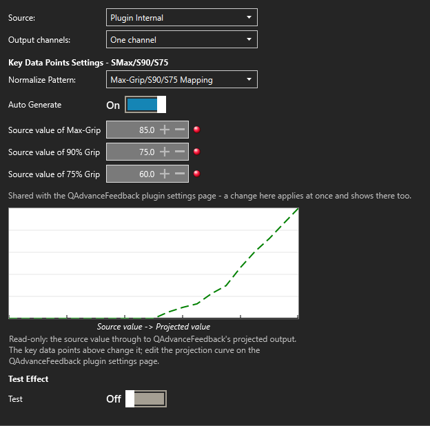 | 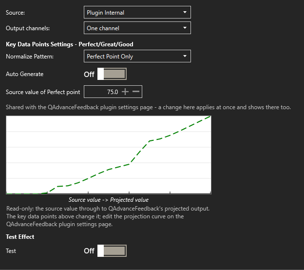 |

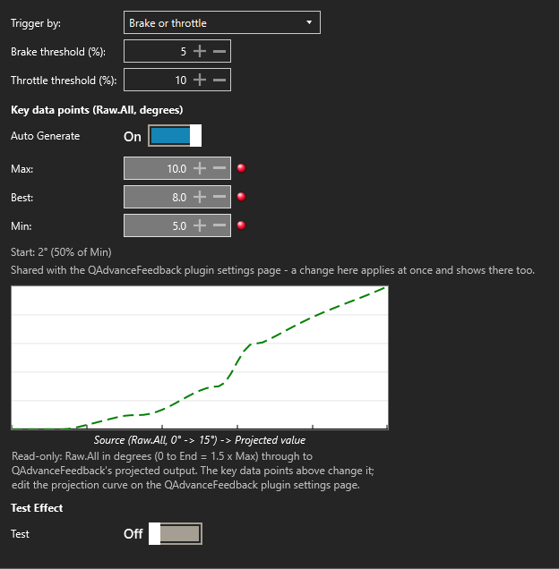

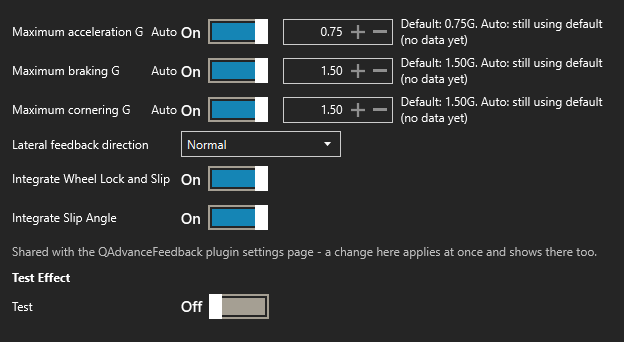

The Wheel Lock Test Effect running with Front/Rear output. The wheel sliders are set to 85 / 70 / 40 /
20, and the Front and Rear Channel sliders show the source values (81 / 36) that give each channel's
combined output, so both balls sit on the curve:

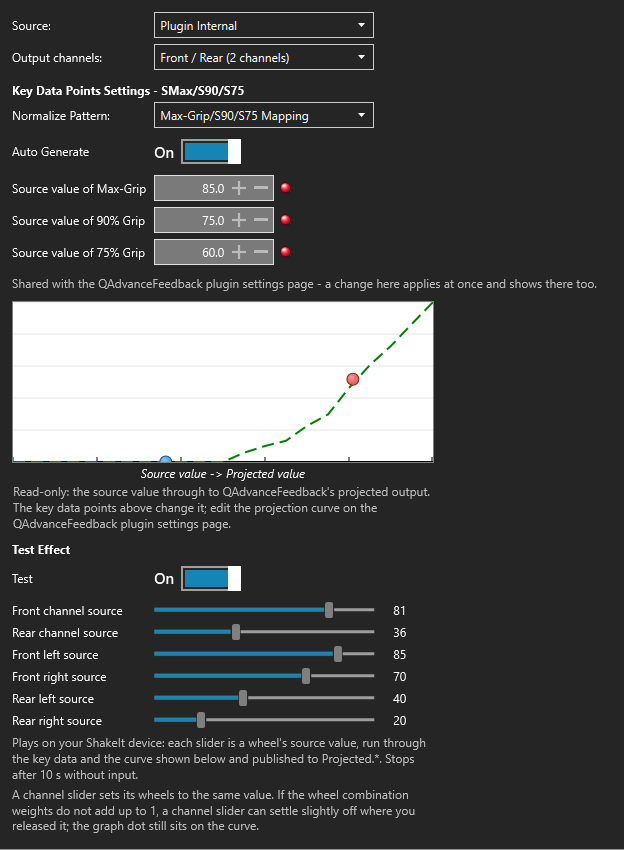

### Clutch Bite (1.2.0)

A clutch-bite feel that simulates a real car: strongest exactly at the bite point, fading smoothly either
side. It is published as `QAdvanceFeedback.Clutch.Bite.Output` (0–100) and played by the native
**Clutch Bite** ShakeIt effect (category "QAdvanceFeedback"). The default shaker tone is 15 Hz at the bite
and 40 Hz away from it, like an engine lugging down as the clutch takes up.

Settings, on the new **Clutch** tab and in the effect's ShakeIt panel (they stay in sync and apply at
once):

- **When apply:** Press and release (default), Press only, or Release only. These follow the pedal's last
  direction of movement, so easing out to the bite and holding keeps vibrating under Release only.
- **Bite point mode:**
  - **Auto** (default): learns each car's bite from standing starts.
  - **Manual:** uses your value exactly.
- **Bite point** (default 50): where the output is 100. Always editable; under Auto it is the starting
  point the learning moves from.
- **Faded range** (default 30): the output reaches 0 at bite ± range, always keeping 5 points clear at
  each end of the pedal. For example, bite 75 / range 30 gives 45 → 75 → 95.
- **S-curve gamma** (default 2.5): a slow start, a steep middle and a gentle top near the bite. 1 is a
  straight line.
- **Fallback clutch axis:** used when the game gives no clutch, and always by the Test Effect. Any SimHub
  controller axis, with an **Invert** option. ShakeIt's device settings hold only output devices, so the
  pedal axis is chosen here: click **Detect**, press the clutch all the way and release it within 5 s.
  The axis that moved most is selected, and Invert is set if the pedal reads high when released.
- Under **Auto** the panel also shows the bite in use, the learning status and **Forget learned bite**;
  under Manual they are hidden.

How Auto learns:
- **Where a sample comes from:** every careful standing start (stopped, in gear, clutch pressed, then
  eased out) gives one sample. It is the clutch position where the engine first loads down, backdated
  to the very start of the RPM dip, or where the car first moves if there is no dip.
- **What is thrown away:** starts where the pedal crossed the bite faster than 30 % of travel per second,
  the throttle swung, or (speed-only) the surface was loose. Holding the pedal still never creates a
  sample.
- **How the bite moves:** it blends from your value toward the learned median with the same ramp as the
  Lock/Slip SMax. Every sample is saved to `QAdvanceFeedback.Parameters.json` (within seconds, and always on exit), so a car keeps
  learning across sessions.
- **Maturity:** after 9 samples within 3 points of each other, the bite becomes a fixed value. The samples
  are dropped and learning stops. **Forget learned bite** starts that car over.

On the plugin page the Clutch tab groups these in categories: **Clutch Bite**, **Clutch axis**, **Bite point
learning** (Auto only), **Bite curve** and **Test Effect**. The **Bite point learning** category also has a section with the learning parameters. It appears on the
plugin page only, not in the ShakeIt panel. It sets what counts as a good standing start (arm level, RPM
dip, confirm speed, fastest release at the bite, throttle change, steady idle) and when a car matures
(samples, spread). **Restore all defaults** resets the Clutch settings too; learned bite points are kept.

The **Test Effect** reads your pedal axis with no game running and plays the real output on the device,
with a ball on the graph. While an axis is readable the slider follows your pedal; otherwise move it
yourself. The slider shows only while the test is on, and resets to 0 when it is switched off. The test
stops after 10 s without input.

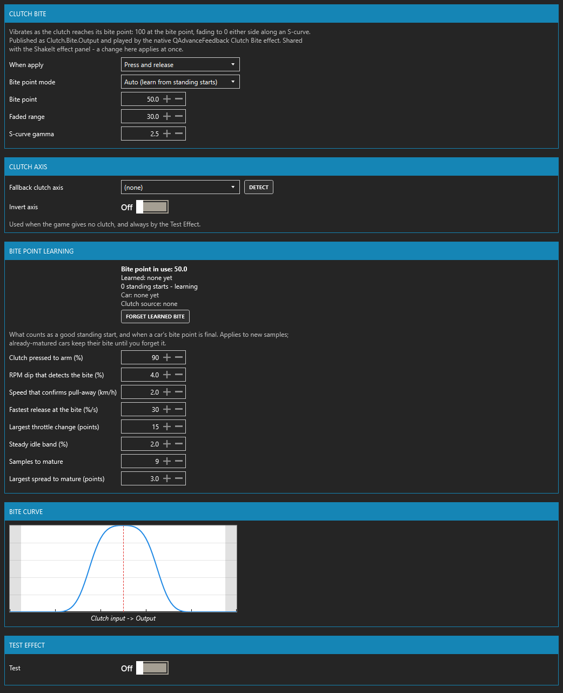

| Clutch Bite | Test Effect running |
|---|---|
| 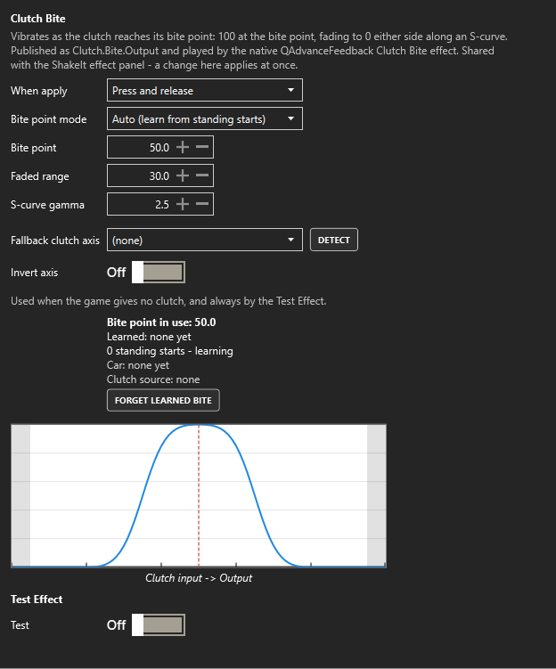 | 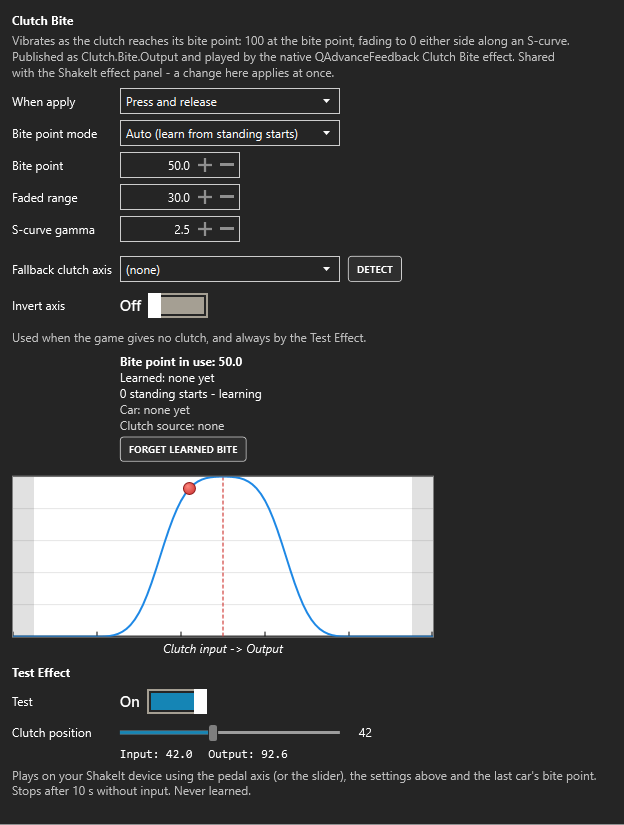 |

Design: [`docs/clutch-bite-design.md`](docs/clutch-bite-design.md).

### Alternate options

These are the original ways to set the plugin up. They give the same values as Option 1 and keep working
unchanged; use them only if you prefer them.

#### Import the property-based profiles

Every value is also published as a SimHub property (`QAdvanceFeedback.WheelLock.Projected.*`,
`QAdvanceFeedback.GForce.*`, `QAdvanceFeedback.Clutch.Bite.Output` and so on), so Custom Effects can drive
your devices:

- **ShakeIt motor rigs** (e.g. Simagic HPR motors): import
  **[`QAdvanceFeedback - WheelLockSlip.siprofile`](docs/setup/QAdvanceFeedback%20-%20WheelLockSlip.siprofile)**.
  Its Custom Effects read this plugin's properties. The ShakeIt "Wheels lock" / "Wheels slip" effects in it
  that export their values as properties are no longer read by this plugin (see below).
- **8-channel pads** (HF-8, Sensit Haptics, any ShakeIt BaseShaker rig): import whichever profile under
  **[`docs/setup/G-Force/`](docs/setup/G-Force/)** matches your pad, with its `.sichannels` mapping.

#### Driving Wheel Lock/Slip from ShakeIt's own calculation

If you'd rather drive Wheel Lock/Wheel Slip from SimHub's own ShakeIt legacy-iRacing calculation instead
of this plugin's built-in one:

1. **Add a QAdvanceFeedback effect to the active ShakeIt profile** (Option 1; any of this plugin's effects
   counts, in ShakeIt Motors or ShakeIt Bass Shakers). ShakeIt's own "Wheels lock" / "Wheels slip" effects
   are not needed: our effect runs ShakeIt's calculation itself with the game data ShakeIt hands it.
2. Switch this plugin's Wheel Lock / Wheel Slip source to **"ShakeIt Built-in"** (here or in a native
   effect's panel). The option is listed only once one of our effects is set up in the active profile (an
   already-selected ShakeIt source stays listed, marked "(not set up)").
3. While that source is selected, a **ShakeIt algorithm** block shows ShakeIt's own settings:
   - Wheel Lock: **Legacy iRacing** (on), **ShakeIt lock sensibility** (50, 0–100 in steps
     of 5), **Lock-only mode** (on);
   - Wheel Slip: **Legacy iRacing** (on), **Mute slip while lock is active** (off).

   ShakeIt's brake/throttle filters follow this channel's own trigger thresholds. Changing an algorithm
   setting starts a separate learning key, so what was learned at the defaults is kept.

The page and the panel tell you when the source cannot work, and the channel then uses Raw (values and
learning key) until it can:
- "Not set up — add a QAdvanceFeedback effect to the active ShakeIt profile. Using Raw."
- "Not supported in this game — using Raw." This uses ShakeIt's own check on what the selected game provides
  (the one that hides Lock/Slip from Add Effect), so it shows as soon as such a game (such as Counter-Strike)
  is selected, running or not.

The old ShakeIt Motors **export profile** ("Export output value as a property") is no longer read. If you
used only that, add one of our effects as above. [`docs/shakeit-export-guide.md`](docs/shakeit-export-guide.md)
is kept for history only.

Everything else (the curve, the pulse, the G-force feel) works exactly the same whichever source mode you
pick. Whatever source you pick, this plugin's own **Plugin Internal** source keeps learning in the
background under its own key, so switching back to it never starts cold.

Full step-by-step instructions, including the exact SimHub menu text, are in the shipped setup guide:
**[`docs/setup/Setup Guide 设置指南.txt`](docs/setup/Setup%20Guide%20%E8%AE%BE%E7%BD%AE%E6%8C%87%E5%8D%97.txt)**.

---

## 3. Configuring the feel

SimHub's settings panel for this plugin has six tabs: Wheel Lock, Wheel Slip, Slip Angle, G-Force,
Clutch and General. Screenshots are below (the Clutch tab is shown in its own section above), followed by
short, practical guidance for the tabs most worth tuning.

**Wheel Lock**

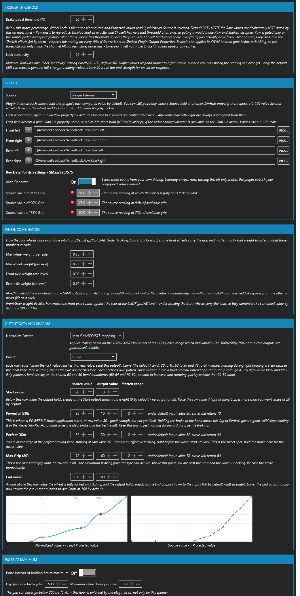

**Wheel Slip**

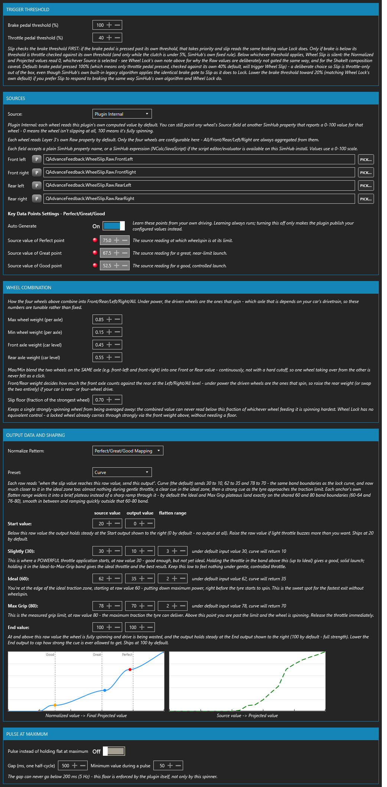

**Slip Angle**

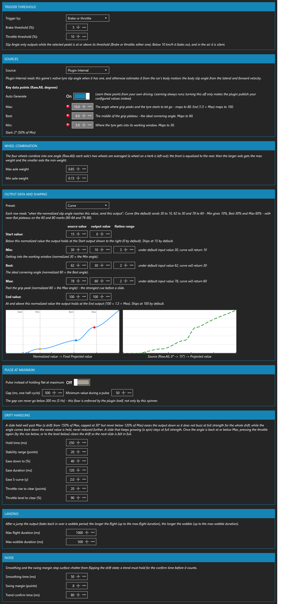

**G-Force**

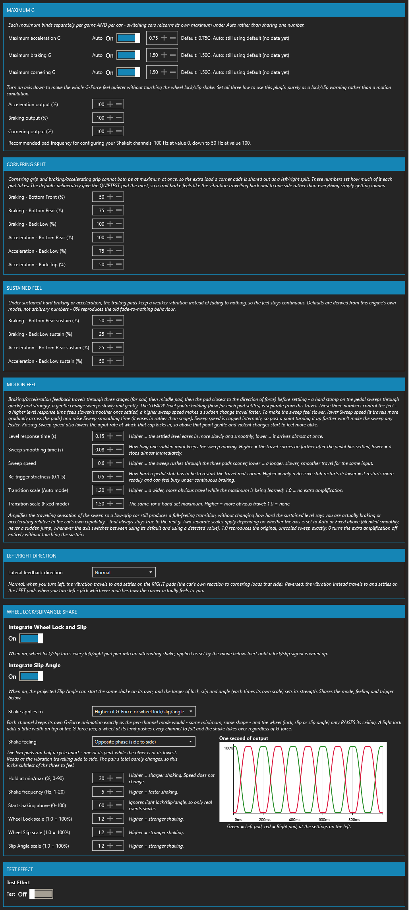

**General**

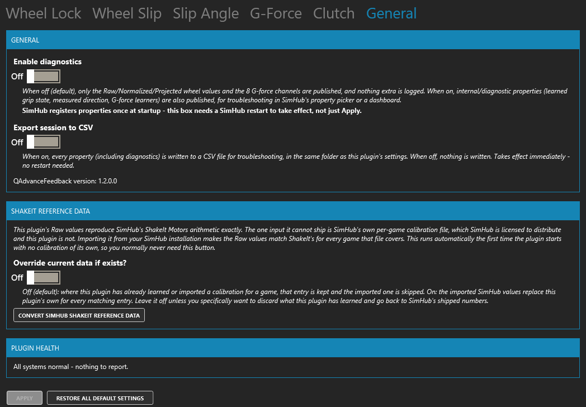

The **ShakeIt Reference Data** section imports SimHub's own per-game calibration file so the Raw values
match ShakeIt's for every game that file covers. It runs automatically the first time the plugin starts
with no calibration of its own, and again after a SimHub update ships new data, so you normally never
need the button. The automatic import never overwrites anything this plugin has already learned —
only ticking **Override current data if exists?** and pressing the button does that.

### Wheel Lock and Wheel Slip

- Want the vibration to kick in later? **Raise the trigger threshold.**
- Want one axle to matter more than the other? **Adjust the wheel combination weights** — the
  front/rear axle weighting in particular is worth tuning to your car and your own preference.
- Feels too aggressive right around the ideal point? **Lower the Ideal output value**, or **raise its
  raw input value slightly**, so that part of the curve reads a gentler cue.
- Want a longer or shorter near-flat plateau around any of the three set points? **Adjust that row's
  flatten range** — wider feels more forgiving of small pedal-pressure variance right at that point; 0
  makes it a sharp corner again.
- Only care about the Max-Grip point and don't need the 90%/75% ranges scaled individually? **Switch
  Wheel Lock's Normalize Pattern to "Max-Grip Only"** — simpler, but only the Max-Grip normalized output
  is then guaranteed reliable.
- Want a lock-up to feel more urgent than a flat buzz? **Enable "pulse instead of holding flat at
  maximum"** for an ABS-like pulsing feel once you hit full lock/slip.
- Using the **ShakeIt Built-in** source? Its **ShakeIt algorithm** block (shown only for that source) holds
  ShakeIt's own lock/slip settings; see
  [Driving Wheel Lock/Slip from ShakeIt's own calculation](#driving-wheel-lockslip-from-shakeits-own-calculation).
- **Every source learns under its own key**, and Plugin Internal always learns, even while another source
  is selected. Switching sources never mixes their learning.

#### Key Data Points (1.0.7.0)

Each channel's **Key Data Points** section sets the source values the plugin treats as your grip
limit and the two steps below it — Max-Grip / 90% / 75% for Wheel Lock, and Perfect / Great / Good
for Wheel Slip.

- **Auto Generate is on by default**, and you can leave it there. The plugin learns these points from
  your own driving.
- **Learning never stops.** Turning Auto off does not stop it — it only changes which numbers get
  published. That is why each row still shows a live `[Learned Value: xx.x]` hint next to your own
  value, and why switching back to Auto is instant rather than a fresh cold start.
- **Your values do not apply immediately.** They take effect once the session has finished calibrating
  *and* you have driven for 30 seconds — whichever takes longer. The boxes stay disabled until then, so
  an edit can never silently fail to take effect. Paused time does not count.
- **Per-Game** (manual mode only) keeps a separate set for each title instead of one shared set. Values
  are stored per *source* as well, so pointing a channel at a different property loads that source's own
  numbers rather than carrying the previous one's across.
- **The first usable learned value is written in for you, once**, and saved immediately — per game if
  Per-Game is on, so a title you have never played sets itself up on its first drive. After that your
  edits are authoritative.
- **A "Reset to default" button appears in manual mode** (hidden under Auto, where there is nothing to
  reset). For a source the plugin recognises it writes the shipped defaults; for one it does not — a
  script or an NCalc expression, which has no honest default — it clears the values instead, so the next
  valid learned value fills them in for you.
- **Restore to Default never clears these.** Everything else on the page resets; your key data points,
  for every game and every source, are left alone.
- **The top point is never above 95**, learned or typed (a value above 95 is stored as 95). A source
  reading 100 means a wheel has already locked or spun up; that is past your grip limit, not at it.
- **After a SimHub restart** the page and the ShakeIt panels show the values saved for the same game,
  car, source and surface you last drove, even before a game is running. If nothing was saved for that
  exact combination, the shipped default is shown.
- Under **Max-Grip Only** (Wheel Lock) or **Perfect Point Only** (Wheel Slip) the two lower rows are
  hidden and kept derived from the top one behind the scenes, so switching back to the three-point
  mapping never finds them stale.
- **Wheel Slip under Auto is always Perfect Point Only**, and the selector is locked to say so. Slip has
  no way to measure its Great and Good points — they can only be derived from the Perfect point — so
  offering the three-point mapping while the plugin generates the values itself would present derived
  numbers as though they had been measured. Switch to manual and the choice becomes real again. Wheel
  Lock measures all three, so both patterns stay available there.

#### Reading the two curve graphs

The **left** graph is what the rows above configure: normalized value in, final projected value out. The
dashed vertical lines mark where your key data points land on that axis — S75/S90/Max-Grip, or just
Max-Grip under Max-Grip Only (Perfect/Great/Good for Wheel Slip).

The **right** graph is the whole chain a driver actually feels: **source value straight through to the
projected output**. It has no single formula — the key data points and the curve compose — so it is
sampled every 5 across the range and the points joined.

### Slip Angle

- **Trigger by** decides which pedal opens the output: Brake, Throttle, or Brake or throttle (the
  default; brake ≥ 5% or throttle ≥ 10%). With neither pedal pressed it stays silent, but it keeps
  tracking the slide, so pressing again mid-drift picks up where it was. Below 10 km/h it fades out,
  and in the air it is silent.
- The **Min / Best / Max** angles map to normalized 30 / 60 / 80, and End (1.5 × Max) maps to 100.
  A **Start** angle, half of Min rounded down to a whole degree (Min 5° → Start 2°), maps to 15; it is
  shown read-only ("Start: 2° (50% of Min)") and is left out when Min is below 2°. The shipped curve
  starts at Start (an angle below it gives no output) and sends Min / Best / Max / End to
  10% / 30% / 60% / 100% output. Under **Auto Generate** they show what
  has been learned for this game, car and source, or the default when nothing has been learned for it
  yet, and cannot be edited. Switch Auto off to type your own (with nothing stored yet the boxes start
  from the default). Your values apply once the car has 30 s of driving and the learner is confident,
  as on the Wheel Lock tab; the first usable learned window is written in for you once, exactly as
  shown.
- **After a SimHub restart** the tab and the ShakeIt panel show the window saved for the game, car and
  source you last drove, even before a game is running — the same rule as the Wheel Lock and Wheel Slip
  key data. Another car, or a first launch, shows the default.
- **Wheel combination** sets how the four wheels make one angle. Max/Min weights default to 0.85 / 0.15.
- **Drift handling**:
  - **Ease down to (%)** (default 40) is where a held drift settles.
  - **Hold time** (250 ms) and **Ease duration** (120 ms) set how quickly a drift is recognised and
    eased. Both are short, so even a quick rally flick is caught.
  - **Stability range** (20 points) is how much the angle may still grow during the hold before it
    counts as a spin rather than a drift. With the defaults, a slide that grows slower than about 80
    points per second is treated as a drift.
  - A drift is only counted from **Max(120% of Max, Min(30°, 150% of Max))**: Max 15° → 22.5°,
    Max 22° → 30°, Max 35° → 42°.
  - **Throttle rise to clear** (20 points) and **Throttle level to clear** (90%): once the angle is
    back at or below Max, a throttle press of more than the rise above the lowest throttle since then,
    or reaching the level, clears the drift.
- **Landing** sets the fade-in after a jump: a longer flight gives a longer fade. Defaults: **Max flight
  duration** 1000 ms, **Max wobble duration** 500 ms (a 200 ms hop gives a 100 ms fade).
- **Noise** stops surface chatter from flipping the drift state.

### G-Force

- If you'd rather not let the plugin learn your car's maximum G automatically, **turn the Auto toggle
  off** and type a fixed maximum G instead.
- In Auto mode, the "Auto detected" readout refreshes about once a second while the settings panel is
  open, so it will show real numbers partway through your first lap rather than only the very next time
  you reopen the panel.
- To change how a *held* G-force feels once the animation settles, **adjust the sustain percentages**.
- Every setting in **Motion Feel** now carries a one-line note beside it saying which way to turn it.
  The shipped **Sweep speed is 0.6**; lower makes the travel across the pads longer and smoother,
  higher makes it snap through the three stages sooner.
- **Re-trigger strictness** (default 0.5) decides how hard a pedal stab has to be to restart the
  travel mid-corner once an earlier one has finished. Raise it if the animation feels busy under
  continuous braking; lower it if a genuine re-application goes unnoticed. It scales with the car’s own
  maximum G, so a gentler car needs a proportionally gentler stab.
- Want the traveling sensation to feel slower and more deliberate, or snappier? **Lower the sweep
  speed** for a slower animation, or **raise it** for a faster one.
- By default, a right-hand turn vibrates more strongly on the **left** side (the side you're being
  pushed toward). If that reads backwards on your rig, the **lateral feedback direction** setting
  reverses it.

#### Cornering, and the friction circle

Cornering grip and braking/accelerating grip cannot both be at maximum at the same time — that's the
friction circle every driver already feels. This plugin models it directly: the combined load is the
hypotenuse of the two, `sqrt(longitudinal² + lateral²)`, and whatever a corner adds *beyond* the
longitudinal effort becomes a left/right split rather than making both sides louder.

**Maximum cornering G** sits with the acceleration and braking maxima and works the same way — Auto by
default, learned per game and per car, with a fixed fallback of 1.5 g. Before this existed, cornering
normalised against a hidden 1.6 g that no setting could reach, so a 1 g car never produced a full split
and a 3 g car saturated early.

**Cornering split** decides how much of that extra load each pad turns into a left/right difference.
The defaults deliberately give the **quietest** pad the most:

| | Bottom Front | Bottom Rear | Back Low | Back Top |
| --- | --- | --- | --- | --- |
| Braking | 50% | 75% | 100% | — |
| Acceleration | — | 100% | 75% | 50% |

Under braking, Bottom Front is already the loudest pad, so giving it the least cornering keeps it from
simply saturating; Back Low is quiet, so cornering shows up there most clearly. The result is that a
trail brake feels like the vibration travelling **back and to one side** as the corner loads up, rather
than everything getting louder in place. Acceleration mirrors it around its own strongest pad.

Worked example — 72% braking with 70% cornering gives a combined 100.4%, so 28.4 points of extra load
to share out:

| Pad | own level | cornering share | left | right |
| --- | --- | --- | --- | --- |
| Bottom Front | 72.0 | 50% → 14.2 | **86.2** | 57.8 |
| Bottom Rear | 36.0 | 75% → 21.3 | **57.3** | 14.7 |
| Back Low | 18.0 | 100% → 28.4 | **46.4** | 0.0 |

**Output scale (%)** — one per axis, default 100. Turn an axis down to make the G-force feel quieter
without touching the wheel lock/slip shake. Set all three low and the plugin becomes purely a lock/slip
warning rather than a motion simulation.
- The wheel lock/slip shake laid on top of the G-force feel can be **disabled entirely**, or tuned
  independently — see below.

#### The wheel lock/slip shake

**Shake applies to** picks how the shake is spread across the eight channels:

| Mode | What it does | Use it when |
| --- | --- | --- |
| **Higher of G-Force or lock/slip** (default, listed first) | Each channel keeps its own G-Force animation exactly as the per-channel mode would — same minimum, same shape — and the wheel only **raises its ceiling**. A light lock adds a little width on top; a wheel at its limit pushes every channel to full and the shake takes over regardless of G-force. | You want both cues at once, with the G-force animation intact underneath rather than replaced. |
| **Each channel's own G-Force level** | Every running channel shakes around its own current level. Channels the G-force isn't driving stay still — under braking that's the top-back pad, under power the bottom-front one. | You want the shake to stay part of the G-force animation, strongest where the load already is. |
| **All channels (follow G-Force strength)** | The strongest channel sets one shake strength, applied to all eight equally — so the otherwise-idle pads shake too. Still grows and eases with the G-force. | The default feels too localized and you want the whole seat involved, without losing the sense of how hard you're braking. |
| **All channels (lock/slip strength only)** | All eight shake equally, travelling from silence up to the lock/slip value. G-force is ignored entirely. | You want lock/slip to read as its own distinct warning, identical whether you're braking hard or barely at all. |

**Switching mode restores that mode's own scale and "start shaking above"**:

| Mode | Scale | Start shaking above |
| --- | --- | --- |
| Higher of G-Force or lock/slip | 1.2 | 60 |
| Each channel's own G-Force level | 1.5 | 5 |
| All channels (follow G-Force strength) | 1.3 | 60 |
| All channels (lock/slip strength only) | 1.0 | 30 |

The threshold is far higher for the two modes that lift every pad at once. In the all-channels modes a
trace of lock is a floor under all eight pads; in the combined mode it lifts every channel's *ceiling*.
Either way a low threshold turns ordinary background lock and slip into a permanent buzz — which is the
thing the threshold exists to stop. A hand-tuned value is overwritten on the switch, deliberately.

The remaining settings apply to every mode:

- **Shake feeling** — how the two pads of a pair relate to each other while shaking. Every pad runs the
  same shape: hold at the top, ease down, hold at the bottom, ease back up. This picks *when* each side
  runs it.

  | Feeling | What it does | Use it when |
  | --- | --- | --- |
  | **Opposite phase (side to side)** (default) | Half a cycle apart — one pad at its peak while the other is at its lowest. Reads as the vibration travelling side to side. | You want the shake to tell you *which* wheel. It is the subtlest of the three to feel, because the pair's total barely changes. |
  | **Same phase (both together)** | Both pads do the same thing at the same moment. | You want the strongest possible sensation. The whole pair swells and drops together, at the cost of carrying no left/right information at all. |
  | **Blending (one leads the other)** | A quarter turn between the two: both start high, one begins dropping while the other is still holding. | You want both at once — some side-to-side movement *and* a swelling total, which is the combination that reads as a real shake. |

  This replaces the old **Both-sides blend (%)** spinner. Only three points on that slider were actually
  distinct to feel, and the hold setting silently cancelled itself out towards the middle of it — so the
  three points became three named choices, and the cancelling went away.

  Picking a feeling **sets the frequency** to that feeling's own value — **5 Hz for Opposite phase,
  10 Hz for the other two**. This overwrites a frequency you had tuned by hand, deliberately, and it is
  where the shipped default comes from too: a fresh install ships Opposite phase at that feeling's own
  5 Hz. Switching *mode* likewise resets the Lock, Slip and Slip Angle scales and "start shaking
  above" to that mode's own values (table above).
- **Hold at min/max (%)** — how long each swing pauses at its extremes before travelling to the other.
  Default 30. Higher feels *sharper*, not faster: the frequency alone sets the speed, and this only
  changes the shape within each cycle. At 0 the pad traces a plain cosine with no flats at all. **The
  period is always 1/f** — the holds are a share *of* the cycle, not an addition to it, so raising this
  never slows the shake down.

  **Blending pins its own hold at 50% and ignores this setting**, which is why the control disappears
  when you choose it — the quarter-turn offset that gives Blending its character is defined in terms of
  that hold.
- **Shake frequency** — how fast it oscillates. Higher is faster. Default 5 Hz, from the shipped
  feeling. One hertz means one full max-min-max travel of a single pad per second — not one
  left-right-left pan.
- **Start shaking above (0–100)** — the lock/slip value a wheel has to reach before anything shakes.
  Default 5. Small amounts of lock and slip are present constantly during ordinary driving, and letting
  those through produced a permanent background buzz that masked the events you actually want to feel.

  It works as a **soft off-switch for the whole integration**: below it the wheel signal is treated as
  absent, so *every* mode falls back to exactly what it would publish with "Integrate wheel lock and
  slip" unticked — plain G-force, no shake. The **scales are not applied** to this test, so turning a
  scale up makes the shake stronger without making it start any earlier.
- **Wheel Lock scale** / **Wheel Slip scale** / **Slip Angle scale** — how strong the shake gets for a
  given amount of locking, slipping or slip angle. Higher is stronger. Switching mode resets all three to
  that mode's own default (1.2 / 1.5 / 1.3 / 1.0, as in the table above). Seat time produced a different
  best value for each mode.
- **Integrate Slip Angle** (on by default, including on upgrade) lets the final Slip Angle value start
  the same shake on its own. The larger of lock, slip and angle, each times its own scale, sets the
  strength. It shares the mode, feeling, frequency and trigger with lock/slip.

The **live preview graph** beside these settings draws one second of what the two pads will actually do
at your current settings — green for the left pad, red for the right — and redraws as you change them.
It is the wave itself, not an illustration: the same code the plugin runs on track produces it.

Once a shake starts it keeps one steady rhythm. A changing lock/slip value moves how *wide* the swing
is and nothing else, so the beat stays where you have locked onto it. When the value falls back below
the trigger the shake finishes the cycle it had already begun rather than cutting off mid-swing, and if
the wheel starts locking again during that tail it rejoins the beat already running. Only a shake that
starts from real silence begins afresh — and when it does, it opens at whichever position moves the pads
*furthest* from where they currently sit, so the first frame is the biggest jolt available rather than a
fade-in. Consecutive shakes also lead with opposite sides, so a shake that stops and restarts quickly
reads as one continuing rhythm instead of two separate events.

Under cornering there is one more rule. The left/right lean normally scales each pad separately, but
while a shake is running **both pads follow the stronger side**. Without that, a real cornering load
pushes the two pads' ranges apart far enough that they stop overlapping — the same side stays louder at
every instant, and the shake stops alternating at all. The trade is deliberate: the cornering lean is
suppressed for as long as the wheel is locking, and returns the moment it stops.

Lock and slip drive one shared oscillation — whichever is currently stronger sets its width, and the
two are always in step, so a wheel that starts slipping mid-lock changes how *wide* the shake is, never
where it is in its swing.

#### Test Effect

The **Test Effect** panel at the bottom of the G-Force tab drives the outputs by hand — the quickest
way to set your ShakeIt levels without needing to provoke a real lock-up on track. It is the same Test
Effect the native G-Force ShakeIt effects show, and it switches itself off after 10 s without input.
To feel it on the device with no game running, use the native QAdvanceFeedback G-Force effects: SimHub
plays property-bound Custom Effects only in game.

Switch it on and three controls appear, one under the other. Drag the ball around the **G-Force pad** to
place the car anywhere in the braking/acceleration/cornering square, drag the ball along the **Lock/Slip
bar** to dial in how hard a wheel is locking or slipping, and the **Slip Angle bar** under it for the slip
angle. The ball is held only while the mouse button is down: drag past the edge and it stays at the
furthest point it can reach, let go anywhere (even outside the control) and it is released at once.
Released near the centre, the pad ball snaps back to the centre; near the left end, a bar ball snaps to 0. The readout underneath shows the simulated G-forces and
wheel value that produces, and the level each of the four channel groups is currently publishing.

The pad is laid out the way the load lands on you: **up is braking, down is accelerating**, and dragging
**left means turning right** (a right-hand corner throws you to your left). The labels say so.

While it is on, the panel drives the real **`QAdvanceFeedback.GForce.*` properties** — the same ones
your ShakeIt effects are bound to, rather than a separate preview. Switching the toggle off, leaving the
G-Force tab, or closing the settings page, hands those channels straight back to the live pipeline.

**Every G-Force setting on this page is applied**, including the Wheel Lock and Wheel Slip scales — the
panel runs the same engine the plugin runs on track, re-fed from the current state of the page rather
than from what was last saved. So what you feel here is what you will feel driving, and editing any
setting above changes it immediately.

The panel produces nothing at all while the toggle is off: no controls, no labels, and no simulated
frames reaching your motors. **Nothing about it is ever saved** — neither the toggle nor the simulation
rate is written to your config, using it never enables the Apply button, and it never pushes the page's
uncommitted edits into the running plugin.

### General

- The **General** tab shows exactly which version of this plugin's DLL is currently loaded — handy when
  reporting an issue or comparing against these release notes — alongside the diagnostics/CSV export
  toggles and the plugin health panel. The health panel is read again each time you open the General
  tab, and at once if a button on the settings page fails.
- **Override current data if exists?** only tells the import button what to do; it is not a setting, so
  ticking it does not enable **Apply**.

---

## 4. Technical details

The full layer-by-layer design — every subsystem's responsibilities, every source file's role, the
resilience model and the health-registry mechanism that surfaces a degraded subsystem to the driver
instead of hiding it — lives in **[`docs/architecture.md`](docs/architecture.md)** (also available in
[简体中文](docs/architecture.zh-Hans.md)). Read that document before changing any algorithm or file
structure; it carries a standing rule that it must be kept in sync with the code.

At a glance, here is what each subsystem is built on and why:

| Subsystem | Core algorithms / mechanisms | What it's for |
|---|---|---|
| **Wheel Lock Raw** / **Wheel Slip Raw** | Reproduces SimHub's own ShakeIt Motors algorithm, dispatched per title across the same nine capability-selected branches SimHub uses (wheel rotation rate, wheel-speed delta, pre-calibrated slip, a calibrated percentile distribution, or a brake+speed+RPM fallback when no per-wheel telemetry exists), then combined per wheel-group by a physically-motivated Max/Min axle blend plus a front/rear weighted blend. Since 1.0.7.0 the calibration behind those branches is a port of SimHub's own — same histogram, same gates, same shipped-preset blend — so the two agree on values, not just on formulas. | The faithful, unnormalized reproduction of SimHub's own well-known algorithm — the common reference point everything else in this plugin builds on. |
| **Wheel Lock/Slip Normalizer** | Re-scales Raw's per-wheel shape against a per-(game, car, source) learned physical-grip reference (a deliberately slow-converging EMA, so a single spike is never mistaken for the car's real limit), cross-calibrated per source via a scale learner anchored to rare, independently-detected "at the physical limit" moments, blended between this session's live evidence and a persisted prior session's value by how *consistent* (not just how numerous) the live evidence has been. | Makes "60" mean the same thing — "right at the limit" — in every car, instead of a number whose meaning drifts with how grippy that particular car happens to be. |
| **Wheel Lock/Slip Projector** | Pushes the normalized 0–100 value through a driver-editable five-anchor curve, smoothed with monotone cubic interpolation so the output can never dip as the input rises, plus an optional pulse-at-maximum stage. | Turns "how severe is this, numerically" into "exactly how this should feel" — the one property tier meant to be bound to a shaker. |
| **G-Force** | A washout-style model that splits a *sustained* G level from a *rate-driven* transient, so a rising G pushes the felt sensation further along a pad chain than the same steady G would; per-game/per-car maxima are learned via a trimmed-pool robust estimator (excludes the top outliers, blends the remaining pool's max and mean) over a real-time rolling window; wheel lock/slip and slip angle optionally superimpose an alternating left/right shake on top. | Gives a seat pad a continuous, directional sense of braking/accelerating/cornering load, independent of and complementary to the wheel channels. |
| **Slip Angle** | Native per-tyre slip angle from a per-game raw-data table (promoted only after sustained evidence; unit auto-detected by voting over hard corners), else a body-slip estimate; one combined angle with front/rear equalisation; a grip-curve learner per game, car, source, axle and surface whose Max is taught only by corroborated traction crossings, protected against impacts and landings; borrowing tiers for a cold car; a monotone 15/30/60/80/100 normalizer (15 at the derived Start angle); a drift attenuator state machine. Shares its crossing gate, corroborated estimator and borrowing resolver with Lock/Slip, each proven bit-identical to the code it was extracted from. | Tells you when the tyres enter and pass their ideal window, without buzzing through a held drift. |

### Building from source

```bash
bash tools/fetch-simhub-refs.sh 9.13.2           # extracts reference assemblies into lib/
MSBuild QAdvanceFeedback.sln -t:Restore,Build -p:Configuration=Release
dotnet test QAdvanceFeedback.Tests/QAdvanceFeedback.Tests.csproj
```

`lib/` is deliberately not committed — those third-party DLLs are extracted fresh from the official
SimHub installer by `tools/fetch-simhub-refs.sh`, targeting SimHub 9.13.2 by default. The algorithm
itself lives in `QAdvanceFeedback/Core/` with no SimHub dependency at all, so it's fully testable on a
machine with no SimHub installed.

**994 tests, 0 build warnings, single-DLL distribution** (`bin\Release\net48\` contains only
`QAdvanceFeedback.dll` and its `.pdb`).

---

## 5. Copyright, licence and references

- **This plugin is an independent, third-party project and is not affiliated with, endorsed by, or
  supported by SimHub or its author, Wotever** (github.com/SHWotever/SimHub).
- **SimHub's reference assemblies are required to build this project but are not redistributed** in this
  repository — `lib/` is git-ignored, and `tools/fetch-simhub-refs.sh` extracts them fresh from the
  official SimHub installer for anyone building from source.
- The Wheel Lock/Wheel Slip Raw algorithm deliberately reproduces the behavior of SimHub's own ShakeIt
  Motors wheel-slip effect, for compatibility of feel with an algorithm SimHub users already
  know — studied via the shipped `SimHub.Plugins.dll` to confirm the arithmetic exactly,
  not reverse-engineered from guesswork.
- **SimHub's own per-game calibration data is not redistributed here either.** That file ships with
  SimHub and is SimHub's to distribute. The plugin imports it from your own SimHub installation
  instead — automatically on start-up, and on demand from the General tab. Without it the Raw values
  still work; they simply calibrate from scratch, exactly as ShakeIt itself does on a fresh install.
- The G-force model's "washout" design — splitting a sustained level from a rate-driven transient, each
  with its own time constant — is adapted from the classical motion-cuing literature used in
  full-motion simulator rigs. This plugin borrows the *idea* (two filtered paths combined, not a literal
  rig's washout filter implementation) to shape a seat pad's feel rather than to drive an actual motion
  platform.

Licensed under the [MIT License](LICENSE).
