# QAdvanceFeedback

[English](README.md) · **简体中文**

一个 SimHub 插件，把车轮抱死、车轮打滑、轮胎滑移角与 G 力都转换成真实的体感——车轮方面是一个**在任何车上含义都相同的 0-100 信号**，滑移角方面**告诉你轮胎何时处于理想窗口**，另外还提供 8 个独立的 G 力通道，服务于完整的座椅震动垫方案。

---

## 1. 这个插件能给你什么

### 可靠的车轮抱死与车轮打滑

每辆车的抓地力表现都不一样。GT 赛车的刹车抱死点和敞轮方程式赛车的脚感完全不同，原始的「这个轮子打滑了多少」这个数字在不同车上的含义也不一样——同样是 0.4，在一辆车上可能什么事都没有，在另一辆车上却已经是车轮即将完全失控的前一刻。这种不一致，正是原始打滑/抱死数值无法直接拿来驱动震动器的根本原因：换一辆车，你就得重新调一遍。

本插件的解决办法是：针对**每一款游戏、每一辆车**，学习这辆车在加速和刹车时实际能达到的最大抓地力。它持续观察你的车速、油门、刹车和 G 力，找出「这辆车」真正的极限在哪里，然后用这个学到的峰值，把默认发布为 `QAdvanceFeedback.WheelLock.Raw.*` 与 `QAdvanceFeedback.WheelSlip.Raw.*` 的逐轮原始信号，重新缩放成 `QAdvanceFeedback.WheelLock.Normalized.*` 与 `QAdvanceFeedback.WheelSlip.Normalized.*`——一个 0-100 的刻度，其区间在任何地方含义都相同：

| 区间 | 含义 |
|---|---|
| 0-30 | 低于力量阈值——轻度使用轮胎 |
| 30-60 | 动力刹车/加速——正逐步接近理想区间 |
| 60-80 | 理想区间，直到测得的抓地极限——数值越高越快，但风险也逐渐增加 |
| 80-100 | 超出极限——车轮正在抱死/打滑，请立即松开踏板 |

**80 是测得的抓地极限**——轮胎所能提供的最大刹车力或牵引力，并非每个弯角都会出现的数值，只有车轮真正达到这辆车自身的学习极限时才会出现。行驶初期读数可能略低于 80，这是暂时的冷启动现象；经过多次真正接近极限的操作后，读数会收敛到 80。

这个归一化后的数值随后还会再经过一次整形——通过一条你可以自行编辑的曲线，或者如果你更喜欢，也可以用简单的线性映射——最终变成 `QAdvanceFeedback.WheelLock.Projected.*` 与 `QAdvanceFeedback.WheelSlip.Projected.*`。**这一层属性才是你应该绑定到硬件上的那一层。** 之所以还要有曲线这一步，是为了让你能够独立于学习机制本身，精确决定 0-100 这个区间里的每一段应该转化成多强、多柔和的振动。

曲线上有三个命名设定点，每个都有自己可编辑的原始输入位置、输出强度，以及一个平滑范围：该设定点两侧多远的范围内（原始输入单位）会保持接近该点自身的输出值，而不是直接穿过它的斜坡，从而形成一小段近乎平坦的平台。默认值（3/2/2）使中间和最高的平台正好落在共享的 60/80 区间边界上，因此曲线在 60-80 这个理想区间内平滑过渡，在此区间之外则急剧上升或下降。将平滑范围设为 0 会让该设定点恢复为未平滑的尖锐拐点。曲线的起始和结束行也各自拥有可编辑的输出值（默认 0/100），而不再固定不变——提高起始输出值可以让存在死区的电机在通道启用后始终保持一个基础嗡鸣；降低结束输出值则可以将最强的提示限制在满强度以下。

**车轮抱死自己的分区标题是「输出数据与整形」，并且以一个归一化模式选择器开头**——车轮打滑没有对应的选择器，因为它始终使用映射式的公式：

- **最大抓地力/S90/S75 映射**（默认）根据最大抓地力的 100%/90%/75% 点分别应用缩放，每个区间独立缩放——100%/90%/75% 的归一化输出均可保证可靠。在这种模式下，三个设定点分别标记为**强劲（Powerful）**、**完美（Perfect）**和**最大抓地力（Max Grip）**。
- **仅最大抓地力**只根据最大抓地力点应用一次整体缩放——在此模式下只有最大抓地力的归一化输出可保证可靠。三个设定点改为标记**轻微（Slightly）**、**理想（Ideal）**和**最大抓地力（Max Grip）**，与本插件最初、更简单的曲线一致。

车轮打滑自己的三个设定点则始终标记为**轻微（Slightly）**、**理想（Ideal）**和**最大抓地力（Max Grip）**。

### 滑移角（Slip Angle）：感受理想的过弯窗口

最快的过弯方式，是让轮胎滑移角保持在抓地力最大的角度之下。SimHub 自带的「Traction loss」效果只能告诉你已经发生的甩尾，**Slip Angle** 则告诉你离极限还有多远：

- **踩下踏板时：** 轮胎进入理想窗口（Min → Best），震动随之增强。
- **越过极限（Max）时：** 震动最强。
- **保持漂移时：** 一旦车辆稳定地保持在明显超过 Max 的滑动中（Max 不超过 20° 时为超过 Max 的 150%），输出会平缓地降到约 40% 并保持。WRC 赛段或漂移不会全程满强度嗡鸣；救回车辆时保持减弱后的数值，不会继续降低。持续变大的滑动（打转）则保持满强度。
- **漂移后再次踩油门：** 角度回到 Max 或以下后，踩下油门（比此后最低油门高出 20 点，或达到 90%）即清除漂移，下一次滑动会以完整强度感受到。
- **回到窗口以下时：** 恢复正常。

它根据你的驾驶，以「度」为单位学习每辆车自己的窗口：

- **Max** 只由真实的「越过极限」时刻教学，而且需要几次独立的时刻相互印证，所以一次碰撞或压路肩不会改变它。
- **Best** 与 **Min** 来自测得的抓地曲线。
- **柏油、砂石/泥地、雪/冰**分开学习，同一辆拉力车在混合路面上会保有三个窗口。路面只采用游戏报告的信息：来源文件能翻译时使用游戏自身的每轮路面字段（rFactor 2、Gran Turismo 7），否则使用SimHub的草地/砂石标志（仅砂石/泥地），绝不猜测。
- 跳跃、落地与碰撞都不会让它学到任何东西。
- 在峰值确认之前（三次一致的穿越），它会借用同车其他路面、其他车或其他游戏的窗口，都没有时使用出厂的 5 / 8 / 10°。

**滑移角的来源。** 游戏自身提供逐轮滑移角时直接使用；否则根据车身运动估算后轴滑移角，此时 Slip Angle 页签及其 ShakeIt 面板会显示**橙色警告**。SimHub没有通用的每轮滑移角属性，因此每款游戏自身的原始遥测字段都列在一个文件`QAdvanceFeedback.SlipAngleSource.json`中（1.2.1，见[添加游戏的每轮滑移角](#添加游戏的每轮滑移角121)）。只有列在该文件中的游戏才能使用其每轮滑移角。随插件提供的清单来自对 SimHub 9.13.2 各游戏读取器的勘察（`docs/slip-angle-spike-report.md`），原生字段只有在本会话中证明可靠后才会启用。

| 来源 | 游戏 |
|---|---|
| **原生直读**（游戏自身的滑移角） | Assetto Corsa Competizione、Assetto Corsa Rally、Assetto Corsa EVO、F1 23 / 24 / 25、Forza Motorsport 7 / Forza Motorsport（2023）、Forza Horizon 4 / 5 / 6、Live For Speed、Wreckfest 2、Project Motor Racing、Drift21、KartKraft、Rennsport、Bus Bound |
| **原生计算**（由轮胎接地点速度计算） | rFactor 2、Le Mans Ultimate；暂定：NASCAR Heat 4 / 5、Tony Stewart's All-American / Sprint Car Racing、SRX: The Game |
| **回退**（车身运动估算，显示橙色警告） | 其他所有有轮胎的游戏：Assetto Corsa、Automobilista 2、iRacing（未验证）、RaceRoom、EA WRC、Dirt Rally 1 / 2、F1 2022 及更早、Gran Turismo 7、BeamNG、Richard Burns Rally、卡车模拟等 |

多数原生游戏的单位没有文档说明。来源文件中注明的单位优先（`"unit"`，用**来源单位**下拉框设置：LFS、Drift21、KartKraft的度、Forza游戏的0-1比值）；由两个速度计算的游戏始终为弧度。插件内不内置任何单位（1.2.1）。对于**自动检测**的游戏（没有`"unit"`），使用其列表中的单位——你在**此游戏的来源类型**中的选择，或驾驶时检测到的结果。这些列表位于插件的配置文件（`SlipAngle.SourceUnits`，绝不在来源文件中），初始为空，可以手动编辑：
- `ByAngle`：数值本身就是角度。
- `AngleUsingRatio1`：0-1的抓地比，而不是角度（0 = 完全抓地，超过1 = 正在失去抓地）。
- `AngleUsingRatio100`：0-100的抓地比。
- `AngleUsingRadians`：经检测确认的弧度（初始为空）。
- `UseCarAngle`：忽略游戏的轮胎数值，始终使用车身角度估算（初始为空）。
- `ChosenByUser`：你在下拉框中选择过单位的游戏（初始为空）。

**此游戏的来源类型**下拉框（Slip Angle页签上位于每轮来源下方，ShakeIt面板上位于关键数据上方）是你对当前游戏的选择。它立即保存到插件的配置文件，绝不写入来源文件，默认值即来源文件中的设置。角度来源为**有每轮轮胎角度时使用**且游戏有每轮来源（遥测类型不为无）时显示：
- **每轮角度**且设置了来源单位：每轮角度（该单位）或车身角度。
- **每轮角度**且为自动检测：每轮角度（自动，显示检测结果）、（角度）、（弧度）、（滑移率0-1）、（滑移率0-100）或车身角度。
- **横向+纵向速度分量**：每轮角度（弧度）或车身角度。

路面与垂直加速度不影响这些选项。只有你的选择与来源文件不同时才会显示**恢复默认**，点击后恢复。

抓地比按0-100数值除以10换算为角度（完全打滑100即10度，即默认最大值）。学到的最大值上限为22.5度（比值2.25），超过13.5度（比值1.35）的弯不参与学习。只有该时刻车身角度至少5度的弯才会参与学习：车身几乎不转动的全油门高速弯，横向G的峰值来自道路而不是轮胎。它使用独立的学习键，并显示橙色警告：「数据源为滑移比（0→100 = 抓地→完全打滑），角度 = 数值 ÷ 10（完全打滑 = 10°）。」此换算之前保存的滑移角数据会丢弃一次并重新学习。不在任何列表中的游戏，会在抓地过弯时与车身角度比较（期间暂按弧度读取）；无论结果是角度、抓地比还是弧度，都会加入对应列表并保存配置，检测随即停止。滑移角关键数据的标题会注明当前单位，例如「由滑移率0-1换算」或「单位检测中，暂按弧度读取」。

#### 添加游戏的每轮滑移角（1.2.1）

当SimHub新增游戏，或你玩的游戏不在清单中时，可以自己添加它的每轮滑移角，无需新版插件。你需要该游戏自身保存各轮胎滑移角的SimHub属性（游戏运行时在SimHub属性列表中查看`DataCorePlugin.GameRawData.*`）。

文件中每款游戏一项：

```json
{
  "id": "AssettoCorsaEVO",
  "slipAngle": [
    "DataCorePlugin.GameRawData.Physics.slipAngle01",
    "DataCorePlugin.GameRawData.Physics.slipAngle02",
    "DataCorePlugin.GameRawData.Physics.slipAngle03",
    "DataCorePlugin.GameRawData.Physics.slipAngle04"
  ]
}
```

- `id`：该条目适用的SimHub游戏ID（当前游戏的ID显示在Slip Angle页签每轮来源的标题中）。不区分大小写，且必须匹配完整的游戏ID：
  - `Game1|Game2|Game3`列出共用同一来源的多款游戏。
  - `*`匹配任意多个字符，`?`匹配一个字符：`FM?|FH?`即FM7、FM8、FH4、FH5、FH6以及将来的FH7。
  - `regex:`开始一个正则表达式，一直到id末尾（其中可以使用`|`）：`regex:^F120(2[3-9]|[3-9]\d)[A-Za-z]*$`匹配F12023到F12099，以及带后缀的ID，例如F12026SeasonPack。与游戏名组合时请放在最后：`MySim|regex:^Other\d$`。
  - **游戏使用哪个条目**，优先级从高到低：1. id正好是这个游戏名（`F12024`）；2. 包含多个部分的id中的该游戏名（`F12019|F12024`、`F12024|regex:...`、`F12024|F12?|F1*`）；3. 只含`?`的通配符（`F1202?`）；4. 含`*`的通配符（`F1*`）；5. 正则（`regex:F1.*`）。同一级别时使用文件中靠前的条目。一个游戏名只能出现在一个条目中（出现在两个条目中会使文件无效），因此精确的游戏名总是优先于同样能匹配的通配符和正则。只有精确ID而没有其他内容的条目（`{ "id": "FH6" }`）表示“该游戏没有每轮来源”，即使`FH?`能匹配它。
  - 可以用`note`说明一个模式匹配哪些游戏；Slip Angle页签会显示它。
- `slipAngle`：四个SimHub属性名，顺序为左前、右前、左后、右后。
- `unit`（可选，即页签上的**来源单位**）：`degrees`、`radians`、`ratio1`（0-1滑移率）或`ratio100`（0-100）。省略时（自动检测）会在驾驶中检测单位，也可以在**此游戏的来源类型**中选择。由速度计算的条目（`atan2PatchVelocity`）没有`unit`：始终为弧度。
- `surface`（可选）：四个每轮路面属性；`surfaceValues`说明它们的数值含义，例如`{ "0": "sealed", "2": "loose", "snow": "lowGrip" }`（键为SimHub中显示的数值；未列出的数值视为未知）。Slip Angle会分别学习柏油（`sealed`）、松散路面和雪/冰（`lowGrip`）的窗口。没有`surfaceValues`（或没有任何车轮的数值被列出）时，使用SimHub自身的草地/砂石标志：三或四个车轮报告时视为松散路面；该游戏在本次会话中至少报告过一次松散路面后，才会重新视为柏油（从不设置该标志的游戏始终视为柏油）。只有`surface`的条目没有滑移角字段，使用车身角度。随插件提供的文件已翻译rFactor 2和Gran Turismo 7的已文档化数值。
- `verticalAcceleration`（可选）：游戏确实会填写SimHub的垂直加速度（`FeedbackData.VerticalAcceleration`——所有游戏都是同一个字段，但多数游戏让它保持为0）时设为`true`。此时颠簸、坡顶和跳跃会暂停Slip Angle学习，也有助于冲击检测。随插件提供的文件为iRacing和Rennsport设置了它。条目可以只包含这个标志（iRacing没有每轮滑移角）。
- `transform` / `longitudinal`（高级）：`atanOfTangent`（字段为角度的正切值）或`atan2PatchVelocity`（角度由`slipAngle`中的横向接地点速度和`longitudinal`中的纵向地面速度计算）。

添加或修改游戏有三种方式：

1. **在Slip Angle页签上**（最简单）。启动游戏，将**全局来源类型模式**设为**有每轮轮胎角度时使用**，然后使用**每轮遥测来源**区域：选择**遥测类型**（**每轮角度**：四个角度属性及其**来源单位**；**横向+纵向速度分量**：各四个，角度为两者的atan2，始终为弧度），勾选**包含每轮路面遥测？**可添加四个路面属性，游戏会填写SimHub的垂直加速度时勾选**包含垂直加速度数据？**，选择属性后点击**应用**，插件会把它们写入`PluginsData\Common`中的文件。遥测类型选择**无**并应用即可删除该游戏的来源。**恢复此游戏的来源**只对插件自带条目的游戏显示（文件仍是该条目时为灰色）；它会立即把自带的条目写入文件，无需点击应用，与页面上其他恢复按钮一致。即使条目由多款游戏共用，也只修改当前游戏，且文件保持精简：游戏先离开原来命名它的条目，然后总会被重新命名——加入第一个来源（`slipAngle`、`surface`、`surfaceValues`、`unit`、`transform`、`longitudinal`、`provisional`、`verticalAcceleration`）完全相同的条目的id（`F1202?|F1203?|F12024`，即使`F1202?`已能匹配它），否则单独成为一个条目。修改`F12024|F1202?|F1203?`中的F12024后，它会变为`F1202?|F1203?`和`F12024`；改回原来的设置后，两者又合并为一个条目。
2. **编辑`PluginsData\Common`中的文件。** 插件首次启动时会用自带的副本创建`SimHub\PluginsData\Common\QAdvanceFeedback.SlipAngleSource.json`。用任意文本编辑器修改即可；下次启动游戏时插件会重新读取。无效的JSON或条目不完整的文件绝不会被覆盖：在你修复之前，插件使用自带的副本，在健康状况区域说明原因，并关闭页签上的编辑器。删除该文件即可恢复插件自带的副本。
3. **编辑仓库中的文件**（解决方案根目录的`QAdvanceFeedback.SlipAngleSource.json`）并重新编译。它会被编译进DLL，成为插件自带的副本：用于创建缺失的文件，也是恢复此游戏的来源的依据。`PluginsData\Common`中已存在的文件不会被替换。

如果你让某款新游戏正常工作了，欢迎在GitHub Discussion中分享它的条目（如果知道单位也请一并注明），以便加入随插件提供的清单。

**快速学习。** 窗口确认之前，每个弯角都会让窗口移动：Max是初始值与各弯角的加权平均，每个弯角按其横向G相对该速度段峰值加权（85%以上为100%，其次80/60/30/10%；第一个弯角以及速度段尚无参考时为10%）。车辆滑动时（车身角度达到10度以上，或滑移率来源超过完全打滑的90%）的弯角会被忽略。LED显示估计的置信度：目前的学习证据（10个弯角为满）乘以最近5个弯角中Max的稳定程度；两者都满时变为绿色，严格确认（三个一致的弯角）也会变为绿色。学习永不停止，绿色的值仍会跟随你的驾驶继续调整。

如果抓地比从不超过 100%，漂移从 100% 开始判定，保持时间更长（Hold time × 6，最多 2 秒）；否则照常从 1.5 × Max 开始，且不超过 30 度上限。

使用车身角度时，橙色提示会说明原因：
- 「此游戏没有轮胎滑移角，使用车身角度。」——该游戏没有每轮来源。
- 「正在检查该游戏的每轮滑移角（车速超过30 km/h并过弯）。在此期间使用车身角度。」——已设置来源；几秒钟的行驶和过弯数据确认后，就会使用游戏自身的角度。
- 「该游戏的每轮滑移角属性没有数据。使用车身角度。」——已设置来源，但行驶中连续10秒四个属性都没有数值（属性名错误，或游戏不发布这些属性）。
- 「全局来源类型模式为“始终使用车身角度”：使用车身角度。」——选择了该模式时，对所有游戏显示（即使游戏有每轮来源）。
- 「此游戏的来源类型为车身角度：使用车身角度。」——这是该游戏自己的选择时显示。

这一行总是说明输出实际使用的角度，而不只是游戏来源中的定义。**全局来源类型模式**与其他设置一起保存（重启后仍保留），**恢复所有默认设置**会把它恢复为**有每轮轮胎角度时使用**。

**随速度变化的横向G。** 在有下压力的赛车（F1、原型车）上，抓地极限随速度上升，同样的横向G在60和220 km/h下意义完全不同。插件按游戏和车辆，以每40 km/h为一个速度段（仅限铺装路面），学习你在极限过弯时的横向G：
- 当横向G达到该速度段峰值的85%，且轮胎角度继续增大而横向G开始下降时，记为一次极限过弯；
- 第一次过弯确定该速度段；之后在均值±45%以内接受，有一次在±15%以内吻合后放宽为±30%，有三次吻合后收紧为±15%（此时该速度段*成熟*）；
- 低于该速度段的过弯视为未到极限而忽略；两次相互吻合且高于该速度段的过弯会取代它。

速度段成熟后，横向G会按车辆最高的成熟速度段换算，再交给滑移角学习，使低速极限弯与高速极限弯同等计数。成熟之前不做任何换算（系数为1），没有下压力的车辆与以前完全相同。速度段保存在运行时文件中（`SlipAngleSpeedBands`），日志列`Diag.SlipAngle.SpeedScale`显示当前使用的系数。

**学习指示灯。** 自动模式下，每个学习值（Lock/Slip的SMax、S90、S75；滑移角的Max、Best、Min）旁有一个小LED，显示其学习程度：红色仅表示尚未学习（0%），橙色低于25%，黄色25-50%，天蓝色50-75%，蓝色75-100%，绿色为已完全学习。鼠标悬停可看到具体置信度（「学习中，置信度63%」）。仅当车辆完全没有自身真实数据时才会借用（来自此车的其他路面、其他车辆、其他游戏，或Slip借用车轮抱死的学习）：左半边显示红色，右半边显示该借用可信程度对应的颜色（50/30/10/30%），并说明来源。获得第一份真实数据后（包括SimHub重启后重新载入的学习），即视为自身学习继续进行：显示单一颜色和自身置信度。设置页中位于输入框左侧，ShakeIt面板中位于右侧；手动模式下隐藏且不占空间。G-Force没有指示灯：它的学习是2分钟滑动窗口，没有成熟度概念。SMax背后的学习证据保存在运行时文件中，重启后按游戏、车辆和路面继续学习，指示灯也从停止处继续。

**参数文件。** `QAdvanceFeedback.Parameters.json`现在保存摘要（单一数值）而非长数组，滑移角学习器部分约为原来的十分之一；重启后关键数据与指示灯显示的内容完全一致地恢复。文件在上一次写入完成5秒后写入，仅在确有变化时写入且只重新生成变化的部分，SimHub关闭时再写入一次。详见`docs/parameters-file-format-report.md`。

**车轮抱死与车轮打滑**现在也会显示同样的橙色警告。当插件内置数据源因游戏不提供车轮数据、只能退回车速/转速估算时，页签与 ShakeIt 面板上都会显示。

最终的滑移角数值还可以驱动 G 力抖动（**Integrate Slip Angle**，默认开启）。

### 面向 8 通道震动垫的丰富 G 力输出

与车轮通道相互独立，本插件还在 `QAdvanceFeedback.GForce.*` 下计算一套完整的 8 通道 G 力信号，专为座椅/靠背震动垫设计，让驾驶者能真切感受到刹车、加速与过弯载荷分别作用在身体的哪个部位：

| 震动垫位置 | 对应身体部位 |
|---|---|
| TopBack | 上背部 |
| LowBack | 腰部/下背部 |
| BottomRear | 大腿根部 |
| BottomFront | 大腿远端 |

这套方案是为完整的 8 通道震动座椅/震动垫设计的——**NextLevelRacing HF-8**、**Razer Freyja**（该设备只有 6 个通道，因此需要把本插件的 8 个通道映射精简到 6 个），以及 **Sensit Haptics MTC-P Extreme 2** 均在支持范围内。

这种体感是一段动画，而不是一个静止的强度值。刹车时，震动会沿着 **LowBack → BottomRear → BottomFront** 的路径移动——从腰部开始，随着重心在刹车时前移，逐渐向下、向前推进到大腿；加速时则反过来，沿 **BottomRear → LowBack → TopBack** 移动——从大腿根部开始，把你向后、向上推入座椅靠背。而每当某个车轮在刹车时真正抱死，或在动力输出下真正打滑时，本插件还会在这套 G 力体感之上叠加一个左右交替的抖动——车子本身仿佛在你身下摇晃，就像现实中（或者非常出色的模拟中）一辆正处于抓地力极限边缘的车，透过座椅传递给你的真实感受一样。

---

## 2. 快速上手指南

你需要的一切都在 **[`docs/setup/`](docs/setup/)** 目录下。推荐使用方案一：原生 ShakeIt 效果。原有的基于属性的配置文件仍然可用，列在本节末尾作为备选方案。

### 方案一（推荐）：原生 ShakeIt 效果（1.2.0）

1. 把 `QAdvanceFeedback.dll` 拷贝到你的 SimHub 目录，重启 SimHub。
2. 在 SimHub 的插件列表中启用 **QAdvanceFeedback** 插件。
3. 在 **振动电机**（ShakeIt Motors，例如 Simagic HPR 电机）或 **振动音响**（ShakeIt Bass Shakers，例如低音震动器或 8 通道震动垫）中打开当前配置文件，选择 **添加效果** -> 分类 **「QAdvanceFeedback」**，并在设备的通道映射中为每个效果绑定一次通道。

到这里就结束了——在本插件自带的 **插件内置** 数据源下，车轮抱死/打滑、滑移角、G 力与离合器结合点开箱即用；无需搭建 Custom Effect、无需输入属性名、无需导入配置文件。

| 效果 | 输出 | 震动器默认频率（低 / 高） | 默认增益 |
|---|---|---|---|
| **车轮抱死**（Wheel Lock） | 单通道、前/后、左/右或每个车轮 | 40 Hz / 20 Hz | 75 % |
| **车轮打滑**（Wheel Slip） | 单通道、前/后、左/右或每个车轮 | 45 Hz / 25 Hz | 75 % |
| **滑移角**（Slip Angle） | 单通道 = `SlipAngle.Projected.All` | 40 Hz / 25 Hz | 75 % |
| **G力 坐垫前部**（G-Force BottomFront） | 左 / 右 = `GForce.Bottom.FrontLeft/FrontRight` | 100 Hz / 60 Hz | 100 % |
| **G力 坐垫后部**（G-Force BottomRear） | 左 / 右 = `GForce.Bottom.RearLeft/RearRight` | 100 Hz / 70 Hz | 100 % |
| **G力 靠背下部**（G-Force BackLow） | 左 / 右 = `GForce.Back.LowLeft/LowRight` | 100 Hz / 70 Hz | 100 % |
| **G力 靠背上部**（G-Force BackTop） | 左 / 右 = `GForce.Back.TopLeft/TopRight` | 100 Hz / 60 Hz | 100 % |
| **离合器结合点**（Clutch Bite） | 单通道 = `Clutch.Bite.Output` | 40 Hz / 15 Hz（结合点处） | 100 % |

效果名称与说明跟随本插件的语言显示在配置文件的效果列表与编辑器中；ShakeIt 自身的 **添加效果** 列表显示英文名称（括号内），因为 SimHub 直接从插件中读取它们。频率与增益是新添加效果的初始值；配置文件中已有的效果保留各自的设置。

- WheelLock/WheelSlip 的输出与 `WheelLock/WheelSlip.Projected.*` 完全一致，按本插件自身的权重合并（而不是 ShakeIt 的取最大值）。其面板提供：
  - **数据源** 下拉框与输出通道路由；
  - **关键数据点**，与本插件设置页面相同：归一化模式（仅完美点，或完美/优秀/良好三点映射）与自动生成。自动模式下数值为只读；关闭自动生成即可输入自己的数值。仅完美点模式下只显示完美点。

  ShakeIt 的曲线区域显示 **源数值 -> 映射数值** 图（即本插件设置页面的右图，**只读**）。它跟随上方显示的关键数据点，包括自动模式下学习到的数值。

  当插件内置数据源对当前游戏退回车速/转速估算时，面板上会显示**橙色警告**。数据源为 **ShakeIt 内置**时，面板还会显示 ShakeIt 算法区块，并在该数据源无法工作时显示「未设置」/「不支持」提示（见下文「改由 ShakeIt 自身的算法驱动车轮抱死/打滑」）。
- Slip Angle 面板提供：
  - **触发方式**与刹车/油门阈值；
  - 自动生成与 **最小 / 最佳 / 最大** 角度（自动模式下只读），以及只读的**起点**一行（最小值的一半、向下取整：「起点：2°（最小值的 50%）」）；
  - 橙色回退警告和一行状态说明。

  曲线区域显示只读的 **Raw.All（度）-> 映射数值** 图。
- G-Force 面板与本插件设置页面相同：每个轴一个 **自动** 开关、最大 G 值输入框和一个说明标签。输入框始终可编辑：自动模式下它是学习到足够数据之前使用的默认值。标签显示默认值以及自动检测到的数值（关闭自动时显示“固定：x”）。其下方是 **左右反馈方向**（正常/反向）以及 **整合车轮抱死与打滑**、**整合滑移角** 两个开关。
- **在 ShakeIt 设备上播放的测试效果**，无需运行游戏。测试效果位于每个面板的最后（WheelLock/WheelSlip：曲线图下方）。滑块与说明只在打开时显示，关闭时滑块（以及 G 球）自动归零。
  - **WheelLock/WheelSlip：** 打开测试并拖动四个滑块（每个车轮一个源数值）。每个数值经关键数据点与图中曲线计算后发布到 `WheelLock/WheelSlip.Projected.*`（包含脉冲），由 ShakeIt 播放。图上的小球显示每个输出通道的位置：每个车轮时前红后蓝、左亮右暗；前/后为红与蓝；左/右为浅灰与深灰；单通道为橙色。

    在 **单通道**、**前/后** 或 **左/右** 路由下，四个车轮滑块上方还会出现通道滑块（**单通道**、**前/后通道**、**左/右通道**）。通道滑块同时移动其所属车轮；它的数值是能得到该通道实际合成输出的源值，因此小球始终落在曲线上。
  - **Slip Angle：** 一个较长的滑块，表示合成角度（度，0 到 3 × Max），终点（1.5 × Max）处有 **100%** 刻度。数值经过真实的归一化、曲线与漂移衰减；保持在刻度之后，小球会像真实保持漂移时那样沿衰减曲线下降。
  - **G-Force：** 与插件设置页面的测试效果相同的 G 球面板、车轮滑条与滑移角滑条，发布 `GForce.*`。
  - 每个测试在 10 秒无操作后自动停止（开关同时关闭）；离开面板或开始另一个测试时也会停止。不会修改任何学习值或设置。这些效果不再显示 ShakeIt 自带的“Test effect”链接。
- 数据源、关键数据点与 G-Force 设置 **与本插件设置页面共享**：任一侧的修改都会立即生效并显示在另一侧（设置页面上其他未应用的修改会保留）。在 ShakeIt 中所做的修改会立即出现在设置页面上，即使设置页面还从未打开过；如果你在设置页面上对同一项设置有尚未应用的修改，会被 ShakeIt 的值取代。**Apply** 只写入你在设置页面上修改过的设置，因此绝不会撤销在 ShakeIt 中所做的修改。在设置页面上切换数据源与在 ShakeIt 中切换完全相同：每个数据源保留自己的配置，选择 Custom 时从当前所用的数据源开始。
- 频率、增益、路由与通道绑定保存在 ShakeIt 配置文件中，与任何 ShakeIt 效果一样。
- 不会移除任何东西：所有已发布的属性保持不变，现有的 Custom Effect 配置文件继续可用。设计文档：[`docs/shakeit-native-effects-design.md`](docs/shakeit-native-effects-design.md)。

这些效果在 ShakeIt 效果编辑器中添加的内容（ShakeIt 自身的增益、频率与通道映射设置会像其他效果一样显示在它们周围）：

| 车轮抱死 | 车轮打滑 |
|---|---|
| 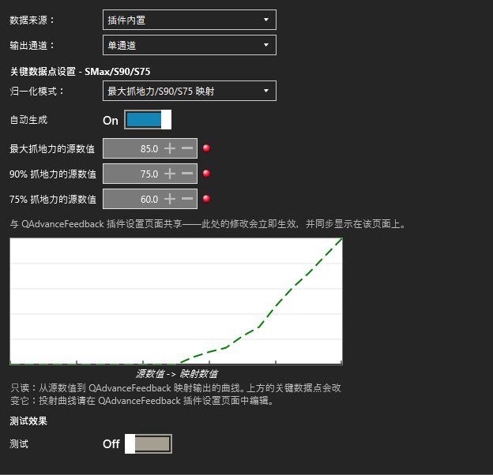 | 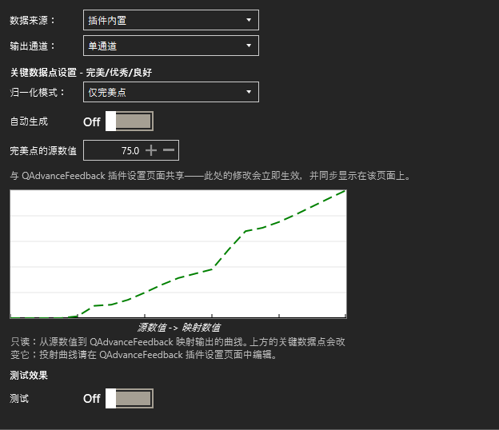 |

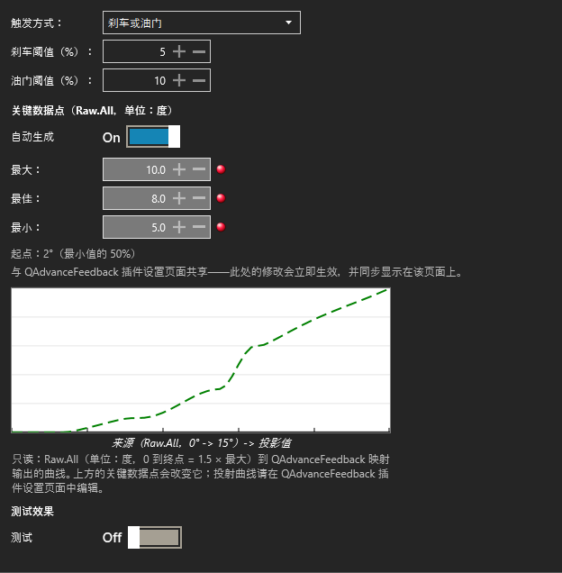

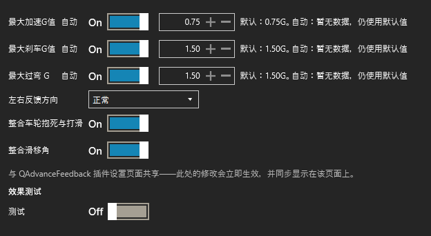

车轮抱死测试效果运行中（前/后输出；车轮滑块为 85 / 70 / 40 / 20，前/后通道滑块显示得到各通道合成输出的源值 81 / 36，因此两个小球都在曲线上）：

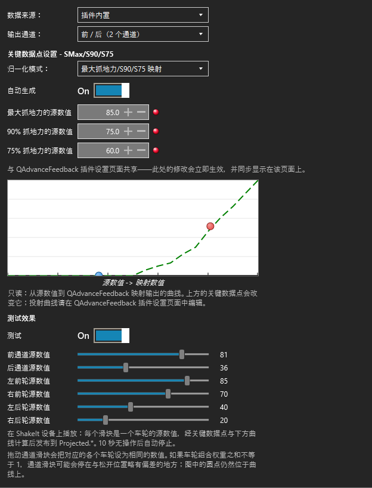

### 离合器结合点（1.2.0）

模拟真实汽车的离合器结合手感：恰好在结合点处最强，向两侧平滑渐弱。发布为 `QAdvanceFeedback.Clutch.Bite.Output`（0–100），并由原生 **离合器结合点**（Clutch Bite，分类"QAdvanceFeedback"）ShakeIt 效果播放。默认震动器音调：结合点处 15 Hz，远离结合点 40 Hz，就像离合器接合时发动机被拖低转速。

设置位于新的 **离合器** 标签页及该效果的 ShakeIt 面板中（两处保持同步并立即生效）：

- **生效时机：** 踩下与松开（默认）、仅踩下或仅松开。依据踏板最后一次移动的方向，因此在"仅松开"下松到结合点并保持不动会持续振动。
- **结合点模式：**
  - **自动**（默认）：从静止起步中学习每辆车的结合点。
  - **手动：** 完全使用你的数值。
- **结合点**（默认 50）：输出为 100 的位置。始终可编辑；自动模式下它是学习的起点。
- **渐变范围**（默认 30）：输出在结合点 ± 范围处降为 0，并始终在踏板两端各保留 5 个点。例如结合点 75 / 范围 30 为 45 → 75 → 95。
- **S 曲线 Gamma**（默认 2.5）：起步缓、中段陡、接近结合点时平缓。1 为直线。
- **备用离合器轴：** 游戏不提供离合器数值时使用，测试效果始终使用它。可选任意 SimHub 控制器轴，并可 **反转**。ShakeIt 的设备设置只包含输出设备，因此踏板轴在这里选择：点击 **检测**，在 5 秒内把离合器踩到底再松开，移动幅度最大的轴会被选中；若踏板松开时读数偏高，会同时打开反转。
- **自动** 模式下，面板还会显示使用中的结合点、学习状态与 **忘记已学习的结合点**；手动模式下隐藏。

自动学习的方式：
- **样本来源：** 每一次平稳的静止起步（停车、挂挡、踩下离合器，然后缓慢松开）产生一个样本。样本是发动机开始被拖低时的离合器位置，并回溯到转速下降的最初时刻；若转速没有下降，则取车辆开始移动的位置。
- **会被丢弃的起步：** 踏板穿过结合点的速度超过每秒 30% 行程、油门大幅变化，或（仅凭车速时）处于松软路面。保持踏板不动不会产生样本。
- **结合点如何变化：** 以与 Lock/Slip SMax 相同的渐进方式从你的数值向学习到的中位数过渡。每个样本都会保存到 `QAdvanceFeedback.Parameters.json`（数秒内写入，退出时必定写入），因此同一辆车会跨会话持续学习。
- **成熟：** 9 个样本彼此相差不超过 3 个点后，结合点成为固定值，样本被丢弃并停止学习。**忘记已学习的结合点** 会让该车重新开始。

在插件设置页面中，离合器标签页按类别分组：**离合器结合点**、**离合器轴**、**结合点学习**（仅自动模式）、**结合曲线** 与 **测试效果**。其中 **结合点学习** 类别还包含一个区域，包含学习参数。它仅在插件设置页面中显示，不出现在 ShakeIt 面板。它决定什么样的静止起步算作有效样本（起步检测的踩下量、转速下降、确认车速、结合点处最快松开速度、油门变化、怠速稳定范围），以及车辆何时成熟（样本数、离散度）。**恢复全部默认设置** 也会重置离合器设置；已学习的结合点会保留。

**测试效果** 无需运行游戏即可读取你的踏板轴，在设备上播放真实输出，并在图上显示小球。能读取到离合器轴时滑块跟随你的踏板，否则可手动拖动。滑块只在测试打开时显示，关闭时归零。10 秒无操作后自动停止。

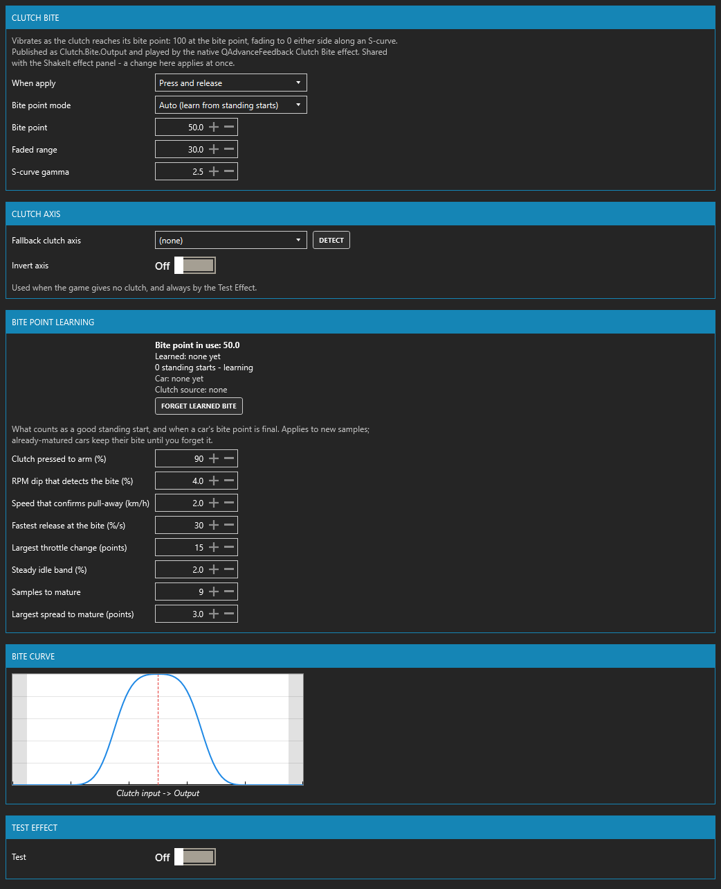

| 离合器结合点 | 测试效果运行中 |
|---|---|
| 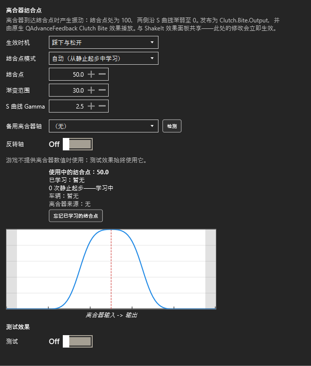 | 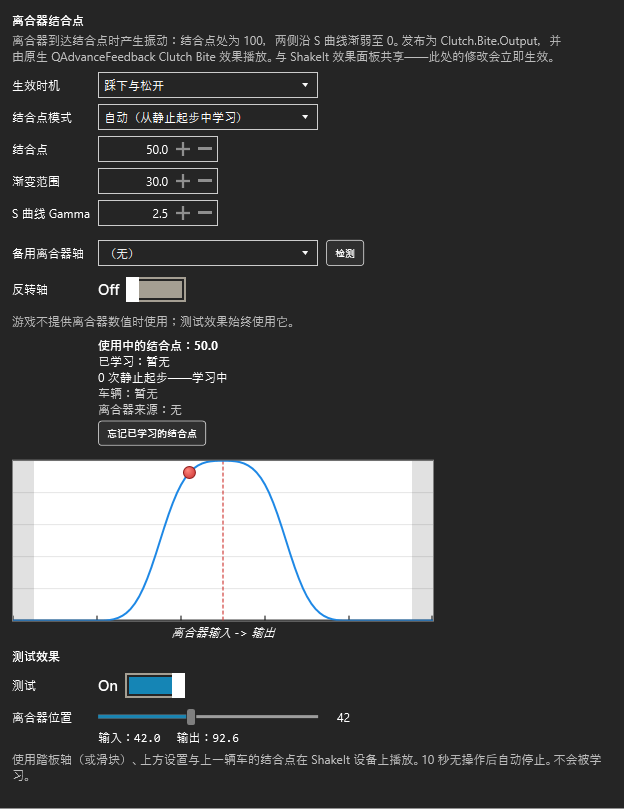 |

设计文档：[`docs/clutch-bite-design.md`](docs/clutch-bite-design.md)。

### 备选方案

以下是原有的设置方式。它们的数值与方案一相同，并且照常可用；只在你更喜欢它们时才需要。

#### 导入基于属性的配置文件

所有数值也都发布为 SimHub 属性（`QAdvanceFeedback.WheelLock.Projected.*`、`QAdvanceFeedback.GForce.*`、`QAdvanceFeedback.Clutch.Bite.Output` 等），可由 Custom Effect 驱动设备：

- **震动电机方案**（例如 Simagic HPR 电机）：导入 **[`QAdvanceFeedback - WheelLockSlip.siprofile`](docs/setup/QAdvanceFeedback%20-%20WheelLockSlip.siprofile)**。其中的 Custom Effect 读取本插件的属性；其中把数值导出为属性的 ShakeIt「Wheels lock」/「Wheels slip」效果已不再被本插件读取（见下文）。
- **8 通道震动垫**（HF-8、Sensit Haptics 或任何 ShakeIt BaseShaker 方案）：导入 **[`docs/setup/G-Force/`](docs/setup/G-Force/)** 下与你设备匹配的配置文件及其 `.sichannels` 通道映射。

#### 改由 ShakeIt 自身的算法驱动车轮抱死/打滑

如果你更希望让车轮抱死/打滑读取 SimHub 自身的 ShakeIt 传统 iRacing 算法，而不是本插件内置的算法：

1. **在当前 ShakeIt 配置文件中添加一个 QAdvanceFeedback 效果**（方案一；ShakeIt Motors 或 ShakeIt Bass Shakers 中本插件的任一效果都可以）。不需要 ShakeIt 自己的「Wheels lock」/「Wheels slip」效果：我们的效果会用 ShakeIt 交给它的游戏数据自行运行 ShakeIt 的算法。
2. 把本插件 Wheel Lock / Wheel Slip 的数据源切换为 **「ShakeIt 内置」**（在本页面或原生效果面板中均可）。只有当前配置文件中已设置了我们的效果时，列表中才会出现该选项（已经选中的 ShakeIt 数据源会保留在列表中，并标为「（未设置）」）。
3. 选中该数据源时，会显示 **ShakeIt 算法**区块，列出 ShakeIt 自身的设置：
   - 车轮抱死：**旧版iRacing**（开）、**ShakeIt 抱死灵敏度**（50，0–100，步长 5）、**仅抱死模式**（开）；
   - 车轮打滑：**旧版iRacing**（开）、**抱死时静音打滑**（关）。

   ShakeIt 的刹车/油门过滤器跟随本通道自己的触发阈值。修改算法设置会使用一个独立的学习键，因此默认设置下学到的内容会被保留。

当该数据源无法工作时，设置页和面板会给出提示，该通道随后使用原始数值（数值与学习键都用 Raw），直到它可以工作为止：
- 「未设置——请在当前 ShakeIt 配置文件中添加一个 QAdvanceFeedback 效果。正在使用原始数值。」
- 「此游戏不支持——正在使用原始数值。」该判断使用ShakeIt自身对所选游戏所提供数据的检查（即在「添加效果」中隐藏Lock/Slip的同一检查），因此只要选中此类游戏（如Counter-Strike），无论是否在运行都会显示。

旧的 ShakeIt Motors **导出配置文件**（「Export output value as a property」）已不再读取。如果你过去只用它，请按上面的步骤添加我们的效果。[`docs/shakeit-export-guide.md`](docs/shakeit-export-guide.md) 仅作历史保留。

无论你选择哪种数据源模式，曲线、脉冲和 G 力体感的其余部分表现完全一致。无论选择哪个数据源，本插件自己的**插件内置**数据源都会在后台、在自己的键下持续学习，因此切回它时永远不会从冷启动开始。

完整的分步说明，包括 SimHub 菜单的确切文字，见随包附带的设置指南：**[`docs/setup/Setup Guide 设置指南.txt`](docs/setup/Setup%20Guide%20%E8%AE%BE%E7%BD%AE%E6%8C%87%E5%8D%97.txt)**。

---

## 3. 调整体感

本插件在 SimHub 设置面板中有六个标签页：Wheel Lock、Wheel Slip、Slip Angle、G-Force、Clutch 和 General。下面是截图（Clutch 标签页见上文对应小节），随后是针对最值得调整的几个标签页的简短、实用建议。

**Wheel Lock**

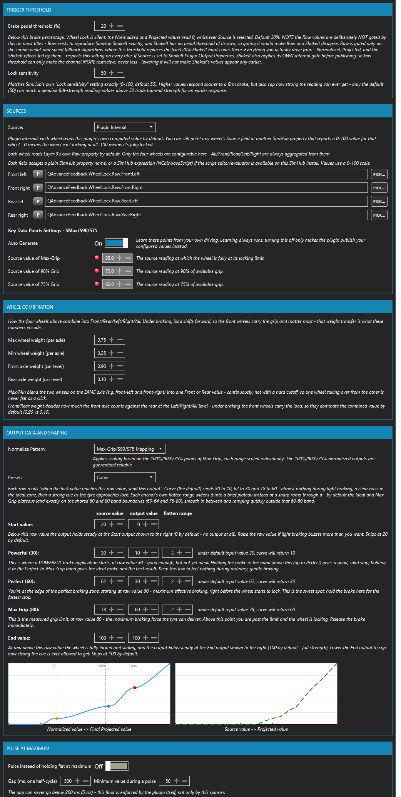

**Wheel Slip**

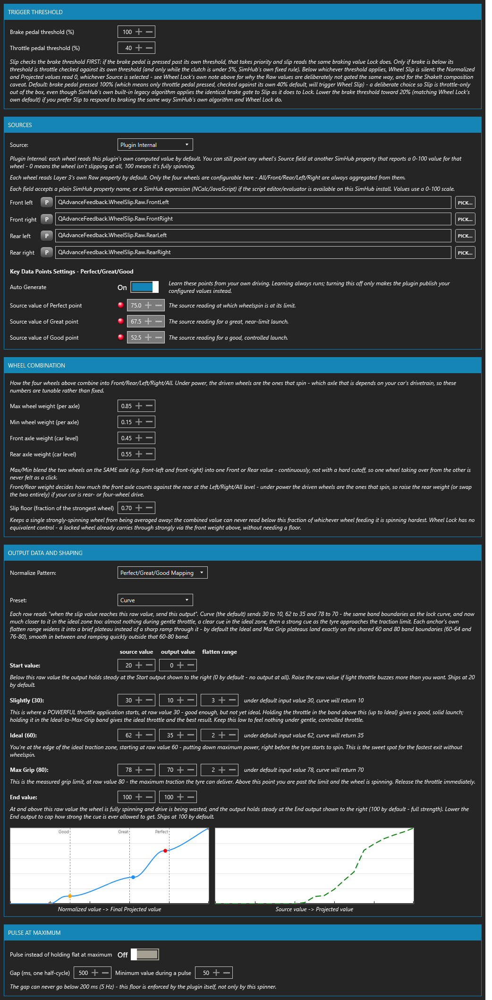

**Slip Angle**

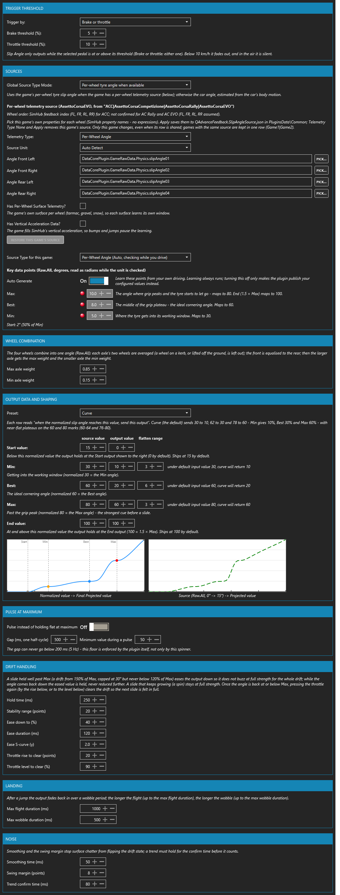

**G-Force**

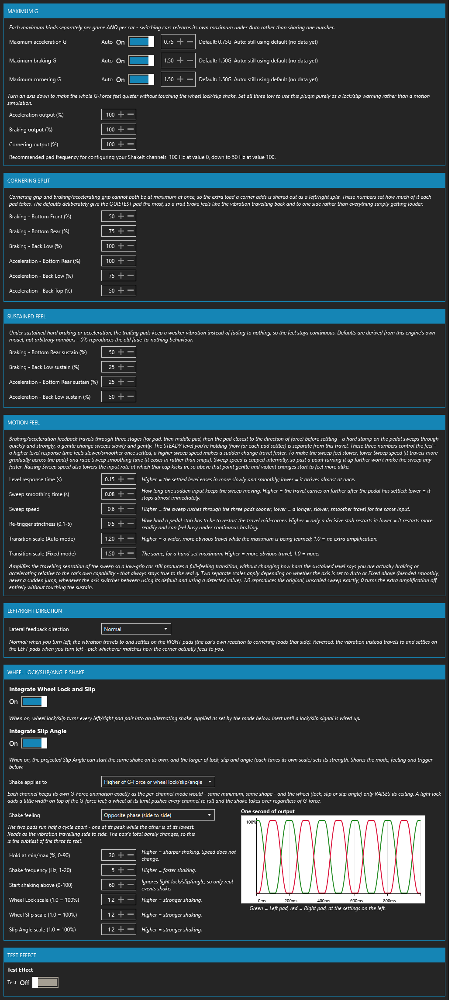

**General**

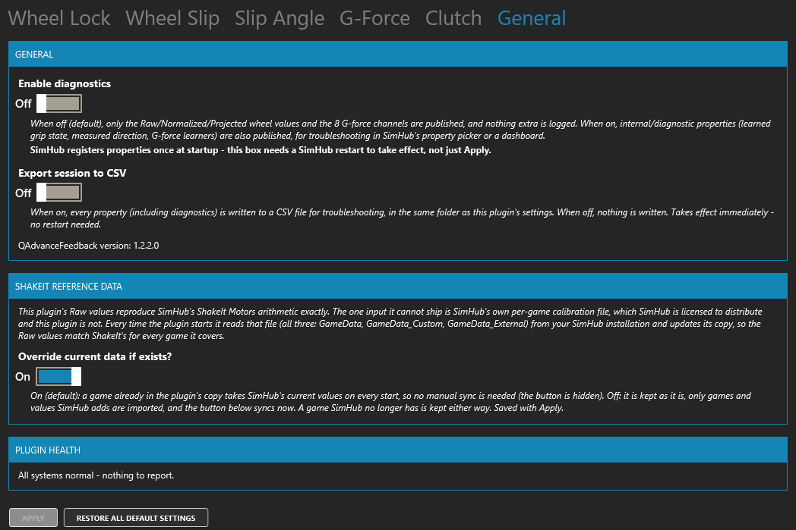

**ShakeIt 参考数据**区域用于导入 SimHub 自带的各游戏标定文件，使 Raw 数值在该文件覆盖的游戏中与 ShakeIt 保持一致。插件首次启动且无自有标定数据时会自动执行，SimHub 更新并提供新数据后也会自动重新导入，因此通常无需手动点击按钮。自动导入**绝不会**覆盖本插件已学习到的数据；只有勾选**如已存在，是否覆盖当前数据？**并点击按钮才会。

### Wheel Lock 与 Wheel Slip

- 想让振动更晚一点才触发？**调高触发阈值。**
- 想让某一根轴的影响更大？**调整车轮组合权重**——尤其是前/后轴的权重比例，值得根据你的车和个人喜好去调。
- 理想点附近的体感太强烈？**调低 Ideal 的输出值**，或者**把它对应的原始输入值调高一点**，让曲线这一段的反馈更柔和。
- 想让任意一个设定点附近的近平坦平台变长或变短？**调整该行的平滑范围**——范围越宽，对该点附近轻微踏板力度波动的容忍度越高；设为 0 则会恢复为尖锐拐点。
- 想让完全抱死/打滑的感觉比一成不变的嗡嗡声更紧迫？**启用「pulse instead of holding flat at maximum」**，在达到完全抱死/打滑后获得类似 ABS 的脉冲式体感。
- 只关心最大抓地力这一点，不需要 90%/75% 区间被单独缩放？**把车轮抱死的归一化模式切换为「仅最大抓地力」**——更简单，但此时只有最大抓地力的归一化输出可保证可靠。
- 使用 **ShakeIt 内置**数据源？它的 **ShakeIt 算法**区块（仅对该数据源显示）存放 ShakeIt 自身的抱死/打滑设置，见上文「改由 ShakeIt 自身的算法驱动车轮抱死/打滑」。
- **每个数据源都在自己的键下学习**，插件内置数据源始终在学习，即使选中的是其他数据源。切换数据源永远不会混合它们的学习结果。

#### 关键数据点（1.0.7.0）

每个通道的**关键数据点**部分用于设定插件将哪些源数值视为抓地极限及其下方的两个参考点 ——
车轮抱死为 最大抓地力 / 90% / 75%，车轮打滑为 完美 / 优秀 / 良好。

- **默认开启“自动生成”**，保持默认即可，插件会从您的驾驶中学习这些数据点。
- **学习从不停止。**关闭自动生成并不会停止学习，只是改变了哪些数值被发布。因此每行仍会在您自己的数值旁边显示实时的
  `[学习值: xx.x]` 提示，切回自动也是立即生效，而非重新冷启动。
- **您的数值不会立即生效。**需要本次会话完成校准**且**已驾驶 30 秒（以较长者为准）。在此之前输入框保持禁用，
  因此修改不会静默失效。暂停时间不计入。
- **每个游戏独立**（仅手动模式）为每个游戏保留单独的数值。数值同时按**源**存储，因此将通道指向另一个属性时，
  会加载该源自己的数值。
- **首个可用的学习值会自动写入一次**并立即保存；若开启了每游戏独立，则每个从未游玩过的游戏都会在首次驾驶时自行完成。
  此后以您的修改为准。
- **手动模式下会出现“恢复默认”按钮**（自动模式下隐藏，因为那时没有可恢复的内容）。对插件能识别的数据源，按钮会写入随包提供的默认值；对无法识别的数据源——例如脚本或 NCalc 表达式，它们没有可信的默认值——则会清空数值，由下一个有效的学习值自动填入。
- **“恢复默认”从不清除这些数值。**页面上其他内容均会重置，但所有游戏、所有源的关键数据点保持不变。
- **最高点永远不超过 95**，无论是学习值还是手动输入值（超过 95 的输入会按 95 保存）。读数为 100 的数据源表示车轮已经抱死或空转，那已经越过了抓地极限，而不是处于极限。
- **SimHub 重启后**，即使还没有运行游戏，设置页和 ShakeIt 面板也会显示你上次驾驶的同一游戏、车辆、数据源和路面所保存的数值。如果这一完全相同的组合没有保存过数值，则显示随包提供的默认值。
- 在**仅最大抓地力**（车轮抱死）或**仅完美点**（车轮打滑）模式下，下方两行会隐藏，并在后台根据顶部数值推导，
  因此切回三点映射时不会发现它们已过时。
- **车轮打滑在自动模式下始终为“仅完美点”**，且选择框会被锁定。打滑通道无法测量优秀点与良好点——它们只能由完美点推导而来——因此在插件自行生成数值时提供三点映射，等于把推导值当作测量值呈现。切换到手动后，这个选择才有实际意义。车轮抱死能测量全部三个点，因此两种模式始终可用。

#### 读懂两张曲线图

**左图**对应上方各行的配置：输入归一化数值，输出最终映射数值。虚线标出关键数据点在该坐标轴上的位置——S75/S90/最大抓地力，或在“仅最大抓地力”模式下只显示最大抓地力（车轮打滑则为 完美/优秀/良好）。

**右图**是驾驶者实际感受到的完整链路：**从源数值一路到最终映射输出**。它没有单一公式——关键数据点与曲线是复合关系——因此按每 5 取样一次并将各点连接成线。

### Slip Angle

- **全局来源类型模式**（最上方，1.2.1）：**有每轮轮胎角度时使用**（默认）在游戏设置了每轮遥测来源时使用游戏的每轮滑移角，否则使用车身角度。**始终使用车身角度**对所有游戏都使用车身角度；此时每轮来源与**此游戏的来源类型**下拉框都会隐藏（ShakeIt面板上的单位下拉框也会隐藏）。点击**应用**后生效。来源只有一个，即插件内置来源（1.2.1：已移除自定义来源——改为在每轮来源区域中编辑游戏的来源）。
- **每轮遥测来源**（仅插件页面）：当前游戏在`QAdvanceFeedback.SlipAngleSource.json`中的条目，点击**应用**后保存，见[添加游戏的每轮滑移角](#添加游戏的每轮滑移角121)。**遥测类型**：无（没有输入框）、每轮角度（**来源单位**——自动检测、角度值（0到360）、弧度值（0到6.28）、滑移率（0到1）或（0到100）——以及左前角度……右后角度）或横向+纵向速度分量（左前横向速度分量……右后横向速度分量，以及左前纵向速度分量……右后纵向速度分量；始终为弧度）。**包含每轮路面遥测？**会添加左前路面……右后路面（每种路面各自学习自己的窗口）。**包含垂直加速度数据？**表示游戏会填写SimHub的垂直加速度（颠簸和跳跃时暂停学习）。**恢复此游戏的来源**（只对插件自带条目的游戏显示）会立即把该条目写入文件。只接受SimHub属性名（不支持NCalc或JavaScript：数值按原样读取）；所有输入框都与下拉框左边缘对齐，页签上所有下拉框宽度相同。
- **路面行**（页签和ShakeIt面板，位于关键数据标题下方）：当前使用的学习键所对应的路面——柏油、砂石 / 泥地或雪 / 冰——以及路面信息的来源（游戏自身的路面字段、SimHub的草地/砂石标志，或未报告），输出淡入新路面时显示“切换中，NN%”。该路面尚无已确认的窗口时，第二行会说明它先使用哪个窗口（这辆车在其他路面上的、其他车辆的、其他游戏的，或出厂的5 / 8 / 10°）。它解释了路面变化时关键数据和学习指示灯为何变化。
- **触发方式**决定由哪个踏板打开输出：刹车、油门，或刹车或油门（默认；刹车 ≥ 5% 或油门 ≥ 10%）。两个踏板都不踩时保持安静，但仍持续跟踪滑动，所以漂移中再次踩下会接着之前的状态。低于 10 km/h 时淡出，腾空时静音。
- **最小 / 最佳 / 最大** 角度对应归一化 30 / 60 / 80，终点（1.5 × 最大）对应 100。**起点**角为最小值的一半、向下取整到整度（最小 5° → 起点 2°），对应 15；它以只读方式显示（「起点：2°（最小值的 50%）」），最小值低于 2° 时省略。出厂曲线从起点开始（低于起点的角度没有输出），并把最小 / 最佳 / 最大 / 终点映射为 10% / 30% / 60% / 100% 输出。**自动生成**下显示针对该游戏、车辆和数据源学到的值，尚未学到时显示默认值，且不可编辑；关闭自动后可输入自己的值（尚无保存值时输入框从默认值开始）。与 Wheel Lock 页签一样，手动值要在车辆行驶 30 秒且学习器足够有把握后才生效；首个可用的学习窗口会按显示的数值自动写入一次。
- **SimHub 重启后**，即使还没有运行游戏，该页签与 ShakeIt 面板也会显示你上次驾驶的游戏、车辆和数据源所保存的窗口——与 Wheel Lock、Wheel Slip 关键数据的规则相同。换一辆车或首次启动时显示默认值。
- **车轮组合**决定四个车轮如何合成为一个角度（最大/最小权重，默认 0.85 / 0.15）。
- **漂移处理**：
  - **降至（%）**（默认 40）是保持漂移时的输出水平；
  - **保持时间**（250 ms）与 **衰减时长**（120 ms）决定多快识别并衰减漂移，两者都很短，即使是快速的拉力甩尾也能捕捉到；
  - **稳定范围**（20 点）是保持期间角度还能增长多少，超过就算作打转而不是漂移。默认参数下，增长慢于约 80 点/秒的滑动会被当作漂移。
  - 漂移只从 **Max(Max 的 120%, Min(30°, Max 的 150%))** 开始计数：Max 15° → 22.5°，Max 22° → 30°，Max 35° → 42°。
  - **清除所需油门增量**（20 点）与**清除所需油门开度**（90%）：角度回到 Max 或以下后，油门比此后最低值高出超过该增量，或达到该开度，即清除漂移。
- **着陆**设置跳跃后的淡入：飞行越久，淡入越长。默认**最大腾空时长** 1000 ms、**最大晃动时长** 500 ms（200 ms 的小跳对应 100 ms 的淡入）。
- **噪声**防止路面抖动来回切换漂移状态。

### G-Force

- 如果你不想让插件自动学习你这辆车的最大 G 值，**关闭 Auto 开关**，然后直接填入固定的最大 G 值。
- 在 Auto 模式下，「Auto detected」（自动检测）读数会在设置面板打开期间每秒左右刷新一次，因此在你完成第一圈的途中就能看到真实数值，而不必等到下次重新打开面板。
- 想改变震动「保持」阶段的体感，**调整 sustain 百分比**。
- **Motion Feel** 中的每一项现在旁边都有一行说明，告诉你往哪个方向调。出厂的 **Sweep speed 为 0.6**；调低会让各震动垫之间的行程更长、更平滑，调高则会更快穿过三个阶段。
- **Re-trigger strictness（重新触发严格度，默认 0.5）** 决定在前一次动画已经走完之后，弯中要多用力地重踩踏板才会重新触发行程动画。如果持续刹车时觉得动画过于吹噪，就调高它；如果一次真实的重新施加刹车没有被察觉，就调低它。它会随车辆自身的最大 G 力缩放，因此更温和的车只需要成比例更温和的重踩。
- 想让整个动画的移动感觉更慢、更从容，或者更迅速？**调低 sweep speed** 可以让动画更缓慢，**调高**则更迅速。
- 默认情况下，右转弯时左侧的振动更强（也就是你被推向的那一侧）。如果你的装备感觉正好相反，**lateral feedback direction（横向反馈方向）** 设置可以把它反过来。

#### 过弯与摩擦圆

过弯抓地力与刹车/加速抓地力不可能同时达到最大——这正是每位驾驶者都已熟悉的摩擦圆。本插件直接对其建模：合成载荷取两者的斜边 `sqrt(纵向² + 横向²)`，而过弯在纵向操作**之外**额外增加的那部分，会转化为左右差异，而不是让两侧同时变响。

**Maximum cornering G（最大过弯 G）** 与加速、刹车两个最大值并列，工作方式完全相同——默认 Auto，按游戏与车辆分别学习，固定回退值为 1.5 g。在此之前，过弯是以一个任何设置都无法触及的隐藏 1.6 g 为基准归一化的，因此 1 g 的车永远无法产生完整的左右差异，而 3 g 的车又会过早饱和。

**Cornering split（过弯分配）** 决定每个振动垫把这部分额外载荷中的多少转化为左右差异。默认值刻意让**最安静**的振动垫承担最多：

| | Bottom Front | Bottom Rear | Back Low | Back Top |
| --- | --- | --- | --- | --- |
| 刹车 | 50% | 75% | 100% | — |
| 加速 | — | 100% | 75% | 50% |

刹车时 Bottom Front 本就是最响的振动垫，因此给它最少的过弯分配可以避免它直接饱和；而 Back Low 较为安静，过弯在那里体现得最清楚。最终效果是：拖刹时感觉像是振动随着弯道载荷增加而**向后、向一侧移动**，而不是所有通道原地变响。加速时围绕其自身最强的振动垫镜像对称。

实例——72% 刹车配合 70% 过弯，合成为 100.4%，因此有 28.4 点额外载荷需要分配：

| 振动垫 | 自身水平 | 过弯分配 | 左 | 右 |
| --- | --- | --- | --- | --- |
| Bottom Front | 72.0 | 50% → 14.2 | **86.2** | 57.8 |
| Bottom Rear | 36.0 | 75% → 21.3 | **57.3** | 14.7 |
| Back Low | 18.0 | 100% → 28.4 | **46.4** | 0.0 |

**Output scale（输出比例，%）**——每轴各一项，默认 100。调低某一轴可以让 G 力体感更安静，而不影响车轮抱死/打滑抖动。若三项都调低，本插件就纯粹作为抱死/打滑警示，而不再是运动模拟。
- 叠加在 G 力体感之上的车轮抱死/打滑抖动可以**完全关闭**，也可以独立调节——见下文。

#### 车轮抱死/打滑抖动

**Shake applies to（抖动应用于）** 决定抖动如何分配到 8 个通道：

| 模式 | 行为 | 适用场景 |
| --- | --- | --- |
| **各通道自身的 G 力水平** | 每个运行中的通道围绕其自身当前水平抖动。未被 G 力驱动的通道保持静止——刹车时是 TopBack，加速时是 BottomFront。 | 希望抖动仍是 G 力动画的一部分，在载荷所在之处最强。 |
| **所有通道（跟随 G 力强度）** | 由最强通道决定统一的抖动强度，并以相同强度应用于全部 8 个通道——因此原本静止的通道也会抖动。强度仍随 G 力变化。 | 觉得默认模式过于局部，希望整个座椅都参与，同时不丢失「刹车有多重」的感受。 |
| **所有通道（仅按抱死/打滑强度）** | 全部 8 个通道以相同强度抖动，从静止一直摆动到抱死/打滑数值，完全忽略 G 力。 | 希望抱死/打滑成为一个独立的警示信号，无论重刹还是几乎没有刹车，感受都一致。 |
| **G 力与车轮抱死/打滑取较大者**（默认） | 每个通道从静止摆动到当前较强者：它自身的 G 力水平，或抱死/打滑数值。两种提示互不掩盖。 | 希望同时获得两种提示：剧烈过弯和刹车仍然可感，而抱死或打滑则在其更强的位置叠加显现。 |

其余设置对所有模式均生效：

- **Shake feeling（抖动手感）**——抖动进行时，成对的两个震动垫之间是什么关系。每个震动垫走的都是同一个波形：在顶端停留、缓降、在底端停留、缓升。本项决定的是两侧**分别在什么时刻**走这个波形。

  | 手感 | 行为 | 适用场景 |
  | --- | --- | --- |
  | **反相（左右交替）**（默认） | 两侧相差半个周期——一侧处于峰值时另一侧处于谷值，感觉像振动在左右移动。 | 希望抖动能告诉你是*哪个*车轮。它是三者中最含蓄的一种，因为两侧总量几乎不变。 |
  | **同相（两侧同步）** | 两侧在同一时刻做同样的事。 | 希望获得尽可能强的体感。整对震动垫一起涨落，代价是不再携带任何左右方位信息。 |
  | **错相（一侧领先）** | 两侧相差四分之一：都从最高点开始，一侧已开始下降而另一侧仍在保持。 | 希望两者兼得——既保留左右移动，又让总量起伏，这正是让人真正感到「抖动」的组合。 |

  本项取代了原先的 **Both-sides blend（双侧混合，%）** 数值框。那个滑动条上真正在体感上有区别的其实只有三个点，而「停留」设置在其中段附近会悄悄把自己抵消掉——于是这三个点变成了三个具名选项，抵消问题也随之消失。

  选择某个手感会**同时把抖动频率设为该手感自己的取值**——**「反相」为 5 Hz，另两种为 10 Hz**。这会有意覆盖你手动调好的频率值；出厂默认值也来源于此：全新安装为「反相」手感，频率即该手感自己的 5 Hz。同样，切换*模式*也会把抱死、打滑与滑移角强度以及「抖动起始阈值」重置为该模式自己的取值（强度/阈值：「G 力与抱死/打滑取较高者」1.2 / 60，「各通道自身 G 力水平」1.5 / 5，「全部通道（跟随 G 力强度）」1.3 / 60，「全部通道（仅抱死/打滑强度）」1.0 / 30）。
- **Hold at min/max（在最小/最大值停留，%）**——每次摆动在两端各停留多久，然后再移向另一端。默认 30。数值越大感觉越**锐利**，而不是越快：速度只由频率决定，本项只改变每个周期内的波形形状。为 0 时，震动垫走的是一条完全没有平台段的标准余弦曲线。**周期恒为 1/f**——停留占用的是周期*内部*的比例，而不是额外追加的时间，因此调高本项绝不会让抖动变慢。

  **错相手感固定使用 50% 的停留并忽略本设置**，所以选择它时本控件会隐藏——赋予错相其特征的那个四分之一偏移，正是以该停留比例定义的。
- **Shake frequency（抖动频率）**——振荡快慢。数值越大越快。默认 5 Hz，取自出厂手感。1 Hz 表示单个震动垫每秒完成一次完整的「最大—最小—最大」行程，而不是一次左右左的摆动。
- **Start shaking above（开始抖动的阈值，0-100）**——车轮需要达到多大的抱死/打滑值才会开始抖动。默认 5。日常驾驶中始终存在轻微的抱死与打滑，若不加过滤，它们会形成一层持续的背景嗡鸣，反而掩盖了你真正想感受到的事件。

  它同时是**整个整合功能的软开关**：低于该阈值时，车轮信号被视为不存在，因此**所有模式**都会退回到与取消勾选「Integrate wheel lock and slip」完全一致的输出——纯 G 力，无抖动。**该判定不应用缩放系数**，所以调高缩放只会让抖动更强，而不会让它更早触发。
- **Wheel Lock scale / Wheel Slip scale / Slip Angle scale（抱死/打滑/滑移角强度）**——在给定的抱死、打滑或滑移角下抖动有多强。数值越大越强。切换模式会把三者重置为该模式自己的默认值（上述四种模式依次为 1.2 / 1.5 / 1.3 / 1.0），因为实际体验得出每种模式的最佳值各不相同。
- **Integrate Slip Angle（整合滑移角）**（默认开启，升级后同样开启）让最终的滑移角数值也能单独触发同一个抖动；抱死、打滑与滑移角各自乘以自己的强度后取最大值决定强度，并与抱死/打滑共用模式、手感、频率与触发阈值。

这些设置旁边的**实时预览图**会绘制当前设置下两个震动垫在一秒内的真实动作——绿色为左侧，红色为右侧——并随你的修改即时重绘。它画的就是波形本身，而不是示意图：绘图所用的正是插件在赛道上运行的同一段代码。

抖动一旦开始，就会保持同一个节奏。抱死/打滑数值的变化只改变摆动的**幅度**，不改变节奏，因此你的身体已经锁定的那个节拍不会被打乱。当数值回落到触发阈值以下时，抖动会先把已经开始的这个周期走完，而不是在半途被切断；如果在这段收尾期内车轮再次开始抱死，它会直接汇入仍在进行的节拍。只有从完全静止开始的抖动才会重新起拍——而每当它重新起拍时，都会从"能让两侧振动垫移动距离最大"的那个位置切入，因此第一帧就是当前可能的最大冲击，而不是缓缓淡入。相邻两次抖动还会由相反的一侧先动，因此一次停止后又很快重新开始的抖动读起来是同一段连续的节奏，而不是两次独立的事件。

在过弯时还有一条规则。左右倾向通常会分别缩放两侧振动垫，但**在抖动进行期间，两侧都跟随较强的那一侧**。否则，真实的过弯载荷会把两侧的取值区间拉开到彼此不再重叠——同一侧在每一个瞬间都更响，抖动也就完全不再左右交替了。这是一个有意为之的取舍：车轮抱死期间过弯的左右倾向会被抑制，抱死一结束便立即恢复。

抱死与打滑驱动的是**同一个**振荡：当前较强的一方决定其宽度，两者始终同相位——因此在抱死过程中车轮开始打滑，只会改变抖动的*宽度*，而不会改变它在摆动中所处的位置。

#### Test Effect（效果测试）

G-Force 标签页底部的 **Test Effect（效果测试）**面板可以手动驱动输出——这是设置 ShakeIt 各项强度最快的方式，无需在赛道上真的制造一次抱死。它与原生 G-Force ShakeIt 效果中的测试效果相同，10 秒无操作后会自动关闭。若要在不运行游戏时在设备上感受到它，请使用原生的 QAdvanceFeedback G-Force 效果：SimHub 只在游戏中播放绑定属性的 Custom Effect。

打开开关后会出现上下排列的三个控件。拖动 **G 力控制板**上的圆球，可以把车辆放置在刹车/加速/过弯方格中的任意位置；拖动下方 **抱死/打滑滑条**上的圆球，可以设定车轮抱死或打滑的程度；再下方的 **滑移角滑条**用于设定滑移角。只有按住鼠标键时才会拖住圆球：拖出控件边缘时圆球停在能到达的最远位置；在任何地方（包括控件外）松开鼠标键，圆球立即释放。在中心附近松开时，控制板圆球会回到中心；在滑条左端附近松开时，滑条圆球归零。下方的读数会显示由此产生的模拟 G 力与车轮数值，以及四个通道组当前各自输出的强度。

控制板的方位按载荷施加到身上的方向排布：**上方为刹车，下方为加速**，而向**左**拖动表示**右转**（右弯会把你甩向左侧）。标签上也是这样标注的。

开启期间，该面板会驱动真实的 **`QAdvanceFeedback.GForce.*` 属性**——也就是你的 ShakeIt 效果所绑定的那些属性，而不是一份独立的预览数据。关闭开关、离开 G-Force 标签页或关闭设置页面，都会立即把这些通道交还给实时管线。

本页**所有 G 力设置都会生效**，包括 Wheel Lock 与 Wheel Slip 强度——该面板运行的正是插件在赛道上运行的同一个引擎，并且是按页面**当前**状态实时重新喂入的，而不是按上次保存的值。因此这里的手感就是赛道上的手感，修改上方任何设置都会立刻反映出来。

开关关闭时，面板不会产生任何东西：没有控件、没有标签，也没有任何模拟帧送到你的电机上。**它的任何内容都不会被保存**——开关与模拟频率都不会写入配置，使用它不会点亮 Apply 按钮，也不会把页面上尚未提交的修改推入正在运行的插件。

### General（常规）

- **General** 标签页会显示当前加载的插件 DLL 具体是哪个版本——便于在提交问题反馈或对照本发行说明时使用，旁边还有诊断/CSV 导出开关和插件健康面板。每次打开 General 标签页时健康面板都会重新读取；设置页面上的按钮操作失败时也会立即刷新。
- **如已存在，是否覆盖当前数据？** 只决定导入按钮的行为，它不是一项设置，因此勾选它不会点亮 **Apply** 按钮。

---

## 4. 技术细节

完整的分层设计——每个子系统的职责、每个源文件的角色、韧性模型，以及把子系统降级状态呈现给驾驶者而不是悄悄隐藏起来的健康状态注册机制——都在 **[`docs/architecture.md`](docs/architecture.md)**（[中文版](docs/architecture.zh-Hans.md)）中。在修改任何算法或文件结构之前，请先阅读该文档；其中有一条硬性规定，要求它必须与代码保持同步。

概览如下，是每个子系统所依赖的机制，以及各自的用途：

| 子系统 | 核心算法/机制 | 用途 |
|---|---|---|
| **Wheel Lock Raw** / **Wheel Slip Raw** | 精确复现 SimHub 自身基于转速/车速的传统 iRacing 抱死与打滑公式（已通过反编译验证），按标题（游戏）在多个分支专用模型（车轮转速、车轮速度差值、预先标定的打滑、学习到的百分位分布，或在没有逐轮遥测数据时使用刹车+车速+转速的兜底方案）之间调度，由能力标志位决定选用哪个分支，再通过一套具有物理依据的 Max/Min 轴间混合与前后轴加权混合，按轮组合并。 | 忠实、未归一化地复现 SimHub 自身广为人知的算法——本插件其余一切内容都建立在这个共同基准之上。 |
| **Wheel Lock/Slip Normalizer** | 依据一个按（游戏、车辆、数据源）分别学习的物理抓地力峰值参考值（一个刻意缓慢收敛的 EMA，确保单次尖峰不会被误判为这辆车的真实极限），对 Raw 的逐轮数值形状重新缩放；再通过一个仅锚定在极少数、独立检测到的「正处于物理极限」时刻的学习器，按数据源分别做交叉标定；并根据本局实时证据的「一致程度」（而不仅仅是数量）在本局实时数据与持久化的历史数据之间做混合。 | 让「60」在任何车上都意味着同一件事——「正处于极限」——而不是一个含义会随这辆车抓地力好坏而漂移的数字。 |
| **Wheel Lock/Slip Projector** | 把归一化后的 0-100 数值送入一条驾驶者可编辑的五锚点曲线，并用单调三次插值平滑，确保输出值不会随输入上升而下降；此外还有一个可选的「达到最大值时脉冲」阶段。 | 把「这有多严重」这个数字，变成「它应该是什么样的体感」——唯一一层设计给震动器绑定使用的属性。 |
| **G-Force** | 一套仿「洗出（washout）」模型，把*持续*的 G 力水平与*由变化率驱动*的瞬态分开，因此上升中的 G 力会比同样大小的稳定 G 力，让体感在震动垫链条上走得更远；每款游戏/每辆车各自的最大值，通过一个基于修剪样本池的鲁棒估计器（剔除最高的一批离群值，再混合剩余样本池的最大值与均值）在一个实时滚动时间窗口内学习得到；车轮抱死/打滑与滑移角还可以选择性地在其上叠加一个左右交替的抖动，并可通过四种模式之一选择该抖动在各通道间的分配方式。 | 让座椅震动垫获得连续、有方向感的刹车/加速/过弯载荷体验，与车轮通道相互独立又彼此互补。 |
| **Slip Angle** | 从`QAdvanceFeedback.SlipAngleSource.json`中按游戏列出的来源读取原生逐轮滑移角（持续证据后才晋升；单位通过激烈过弯投票自动检测），否则使用车身侧滑估算；带前后轴等效换算的单一合成角度；按游戏、车、数据源、轴与路面的抓地曲线学习器，其 Max 只由经佐证的牵引力穿越教学，并防护碰撞与落地；冷车借用档位；15/30/60/80/100 单调归一化（15 位于推导出的起点角）；漂移衰减状态机。与 Lock/Slip 共享穿越门、佐证估计器与借用解析器，均已证明与提取前代码逐位一致。 | 告诉你轮胎何时进入、何时越过理想窗口，同时不会在保持漂移时一路嗡鸣。 |

### 从源码构建

```bash
bash tools/fetch-simhub-refs.sh 9.13.2           # 把参考程序集解压到 lib/ 目录
MSBuild QAdvanceFeedback.sln -t:Restore,Build -p:Configuration=Release
dotnet test QAdvanceFeedback.Tests/QAdvanceFeedback.Tests.csproj
```

`lib/` 目录刻意不纳入版本控制——这些第三方 DLL 由 `tools/fetch-simhub-refs.sh` 从官方 SimHub 安装程序中重新提取，默认针对 SimHub 9.13.2。算法本身位于 `QAdvanceFeedback/Core/`，完全不依赖 SimHub，因此即使在一台没有安装 SimHub 的机器上也能完整测试。

**994 个测试，0 个编译警告，单 DLL 发布**（`bin\Release\net48\` 下只有 `QAdvanceFeedback.dll` 及其 `.pdb`）。

---

## 5. 版权、许可与参考资料

- **本插件是一个独立的第三方项目，与 SimHub 及其作者 Wotever（github.com/SHWotever/SimHub）没有任何隶属、授权或支持关系。**
- **构建本项目需要 SimHub 的参考程序集，但本仓库不会重新分发它们**——`lib/` 已被 git 忽略，`tools/fetch-simhub-refs.sh` 会为任何从源码构建的人，从官方 SimHub 安装程序中重新提取这些文件。
- Wheel Lock/Wheel Slip 的 Raw 算法刻意复现了 SimHub 自身 ShakeIt 传统 iRacing 车轮打滑效果的行为，目的是与 SimHub 用户已经熟悉的算法在体感上保持一致——这是通过反编译随包发布的 `SimHub.Plugins.dll` 来精确核对算法本身得到的，而不是靠猜测反推出来的。
- **SimHub 自带的各游戏标定数据同样不在本仓库内重新分发。** 该文件随 SimHub 一同发布，其分发权属于 SimHub。本插件改为从您本地的 SimHub 安装目录导入——启动时自动执行，也可在“通用”标签页手动触发。即使没有它，Raw 数值仍然可用，只是需要从零开始标定——这与 ShakeIt 自身在全新安装时的行为完全相同。
- G 力模型的「洗出（washout）」设计——把持续水平与由变化率驱动的瞬态分开，各自使用自己的时间常数——改编自全动感模拟器平台所使用的经典体感线索（motion-cueing）文献。本插件借用的是这个*思路*（两条经过滤波的路径相结合），而不是照搬某个具体平台的洗出滤波器实现，目的是塑造震动垫的体感，而不是驱动真实的动感平台。

以 [MIT 许可证](LICENSE)授权。
